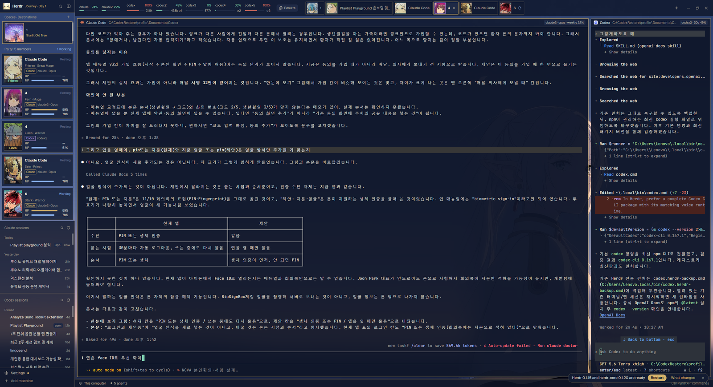
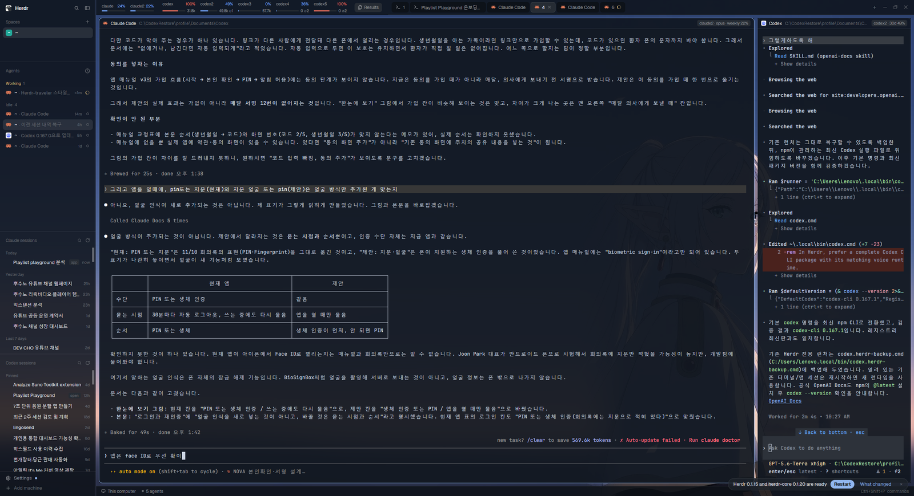

# Frieren — Herdr layouts

Two Windows layouts for the [Herdr](https://herdr.dev) desktop app, made for running several
**Claude Code** and **Codex** accounts side by side. Every saved Claude and Codex session is one click
away, every account's plan usage sits in the top bar, and every pane says which account and model it
runs on. A Frieren wallpaper fills the whole window and shows through translucent terminals and sidebars.

- **Frieren Journey** (`frieren-journey`): the same tools dressed as a fantasy party, in the style of
  [herdr-traveler](https://github.com/franky5440-afk/herdr-traveler). Each agent is a party member card
  with HP/MP bars, each space is a place on the journey, and each tab carries its member's face.
- **Frieren** (`frieren`): the plain glass look.





> Windows 10/11 only. The UI text is English.

## Features

Both layouts:

- **Session lists for Claude and Codex**: every saved session in the sidebar, grouped by date
  (Today, Yesterday, Last 7 days, …), with live status marks (working, needs you, done, idle).
  Click to resume in its folder. If a terminal already runs it, that terminal gets focus.
- **Switch accounts or agents per session**: right-click a session to continue it with another
  account, or hand it to the other agent (Claude → Codex, Codex → Claude). Handed-over pairs are
  remembered (`⇄`), and later moves pass on only the new turns.
- **Session search** (`Ctrl+Shift+S`): a popup that searches every session by title and folder, with
  All / Claude / Codex filters and keyboard navigation.
- **Usage gauges**: one chip per account in the top bar with its weekly or 5-hour usage, colored by how
  full it is (blue → yellow at 70% → red at 90%). Codex chips also show credits and free reset passes.
  Hover for every window and its reset time. Click to refresh.
- **Account on every pane**: each pane header shows `claude2 · Opus 5.5 · weekly 3%`, also for agents
  you typed by hand into a shell (read from the running process).
- **Results panel** (`Ctrl+Shift+R` or the `Results` button): the newest files in the focused terminal's
  folder, with image and video thumbnails, a preview window, and an "Attach to agent" button.
- **Smart paste** (`Ctrl+V`): pastes text and copied files. A screenshot on the clipboard is saved as a
  PNG and attached, so Claude Code and Codex pick it up.
- **Glass look**: terminals are 75% opaque over the wallpaper, and sidebars, menus and dialogs are
  translucent too.

Frieren Journey adds:

- **Party cards**: one card per agent, drawn as a member of Frieren's world (16 characters: Frieren,
  Fern, Stark, Himmel, Heiter, Eisen, Sein, Ubel, Land, Denken, Methode, Flamme, Serie, Kanne, Lawine,
  Wirbel). A card shows the portrait, the tab name and status, the resumed session's title (or
  "Fern · Mage"), a `Claude` / `Codex` tag with the account and model, and two bars:
  **HP** = what's left of the short limit (5 hours), **MP** = what's left of the weekly limit (or the
  longest one the plan has).
- **Status effects** on the portrait: working = a turning magic circle with sparkles, needs help = a
  flashing `!`, resting = `z z z`, done = a flower.
- **Places for spaces**: each space gets one of eight places (Royal Capital, Old Ruins, Flower Hill,
  Forest Camp, Rampart Watchtower, Town Street, Starlit Old Tree, Moonlit Ruined Castle) as a framed
  painting, plus a git summary across its terminals (uncommitted files, unpushed commits, repos without
  a remote).
- **Faces on tabs**: each tab shows its party member's face, framed in that character's color.
- **Journey · Day N** in the top-left corner, counted from the day you first open the layout.
- Navy and gold theme (`frieren-journey`), square gold frames. Fold the sidebar (`Ctrl+Shift+B`) and the
  party shrinks to a column of faces.

## Requirements

| What | Why |
|---|---|
| Windows 10/11, Windows PowerShell 5.1 | the mods use PowerShell, `.cmd` wrappers and Windows APIs |
| [Herdr](https://herdr.dev) desktop app with `hc` on PATH | the app itself |
| Python 3.10+ on PATH, with [Pillow](https://pypi.org/project/pillow/) | usage, session lists, thumbnails, clipboard images |
| Claude Code at `~/.local/bin/claude.exe` and the Claude desktop app | the Claude session list |
| Codex desktop app (`%LOCALAPPDATA%\OpenAI\Codex\bin\…\codex.exe`) | the Codex session list and gauges |
| `git` on PATH (Journey) | the git summary under each space |
| `ffmpeg` (optional) | video thumbnails in the results panel |

```powershell
python -m pip install pillow
```

## Install

### Ask your agent (easiest)

In a Herdr terminal, ask Claude Code or Codex:

```
Add the Herdr layouts from https://github.com/CHO-kr/frieren
```

Herdr's own instructions (`~/.config/herdr-app/AGENTS.md`) tell the agent how to read the recipe,
copy the files without overwriting yours, check every mod and switch to the layout.

### By hand

```powershell
git clone https://github.com/CHO-kr/frieren "$env:TEMP\frieren"
$src = "$env:TEMP\frieren"; $h = "$HOME\.config\herdr-app"

# Stop if a name is already taken (rename the new one first)
$taken = @(Get-ChildItem "$src\mods" -Directory | Where-Object { Test-Path "$h\mods\$($_.Name)" } | ForEach-Object { "mods\$($_.Name)" }) + @('layouts\frieren.json','layouts\frieren-journey.json','themes\frieren-ink.json','themes\frieren-paper.json','themes\frieren-journey.json','backgrounds\frieren.jpg' | Where-Object { Test-Path "$h\$_" })
if ($taken) { "Already there, rename before copying: $($taken -join ', ')" } else {
  foreach ($d in 'layouts','themes','backgrounds','mods') { New-Item -ItemType Directory -Force "$h\$d" | Out-Null }
  foreach ($m in Get-ChildItem "$src\mods" -Directory) {
    # mod.json first, so Herdr doesn't dock the mod into the layout you're looking at
    New-Item -ItemType Directory "$h\mods\$($m.Name)" | Out-Null
    Copy-Item "$($m.FullName)\mod.json" "$h\mods\$($m.Name)"
    Copy-Item "$($m.FullName)\*" "$h\mods\$($m.Name)" -Exclude mod.json -Recurse
  }
  Copy-Item "$src\layouts\frieren*" "$h\layouts"
  Copy-Item "$src\themes\*" "$h\themes"
  Copy-Item "$src\backgrounds\*" "$h\backgrounds"
}
```

Then **merge** the keys into your `~/.config/herdr-app/keys.json`. Don't replace the file, and check
that you don't already use these keys:

```json
{
  "layout:frieren": {
    "ctrl-shift-s": "mod.open:session-search",
    "ctrl-shift-r": "layout.toggle:results"
  },
  "layout:frieren-journey": {
    "ctrl-shift-s": "mod.open:session-search",
    "ctrl-shift-r": "layout.toggle:results"
  },
  "terminal": {
    "ctrl-v": "smart-paste.paste"
  }
}
```

Check the mods and switch to a layout:

```powershell
foreach ($m in Get-ChildItem "$env:TEMP\frieren\mods" -Directory) { herdr-app check "$HOME\.config\herdr-app\mods\$($m.Name)" }
herdr-app do layout.switch --name frieren-journey   # or: --name frieren
```

Frieren Journey reads what the Frieren mods collect (usage, session lists), so install all twelve mods
even if you only use Journey.

## Quick start

| Do this | What happens |
|---|---|
| `Ctrl+Shift+L` | cycle layouts (back to yours, to Frieren and to Frieren Journey) |
| Click a session in **Claude sessions** / **Codex sessions** | resume it in a new tab in its folder, or focus it if it's already open |
| Right-click a session | continue with another account, hand over to the other agent, or hide it |
| `Ctrl+Shift+S` | search every session. `Tab` switches filter, `↑`/`↓` move, `Enter` opens, `Esc` closes |
| Click / hover a usage chip | refresh now / see every window, its reset time, plan and login |
| Right-click a Codex chip | spend one free reset pass (asks first; it can't be undone) |
| `Ctrl+Shift+R` or `Results` | open the results panel for the focused terminal's folder |
| `Ctrl+V` in a terminal | paste text, files, or a screenshot as an attachment |
| `Ctrl+Shift+B` | fold the sidebar to a 44px rail |
| Click a party card (Journey) | focus that agent's terminal |
| Rename a tab to `Fern`, `Stark`, … (Journey) | that tab's agent becomes that character |

### More than one account

The gauges and menus find extra accounts from small wrapper scripts in `~/.local/bin`:

```bat
@echo off
rem ~/.local/bin/claude2.cmd: Claude Code with a second account
set "CLAUDE_CONFIG_DIR=%USERPROFILE%\.claude-2"
"%~dp0claude.exe" %*
```

```bat
@echo off
rem ~/.local/bin/codex2.cmd: Codex with a second account in ~/.local/share/codex-accounts/codex2
setlocal
set "CODEX_HOME=%~dp0..\share\codex-accounts\codex2"
call codex --no-daemon %*
exit /b %errorlevel%
```

Log in once with each wrapper (`claude2`, `codex2`), then click the gauges to refresh.

## Customize

- **Wallpaper**: replace `backgrounds/frieren.jpg` (same name), or change `background.image` in
  `layouts/frieren.json` / `layouts/frieren-journey.json`.
- **Terminal see-through**: `terminal_opacity` in the layout (`0.75` now; `1` is solid, `0.2` shows the
  wallpaper clearly).
- **Usage bar width**: the `usage` block is a fixed `818px`, sized for 2 Claude and 5 Codex accounts.
  Allow about 78px per Claude chip, 104px per Codex chip and 90px for the button.
- **Colors**: `themes/frieren-ink.json` (dark), `themes/frieren-paper.json` (light) and
  `themes/frieren-journey.json`. The alpha in `chrome`, `surface`, `popover` and `background` controls
  how translucent each part is.
- **Who plays whom** (Journey): characters are handed out in roster order and each tab keeps its own.
  Name a tab after a character, or map tab names in `mods/journey-party/jobs.json`:
  `{ "api": "stark", "docs": "fern" }`.
- **Which place a space is** (Journey): picked from the space's name. Pin one in
  `mods/journey-spaces/places.json`: `{ "my-project": "camp" }` (`capital`, `ruins`, `meadow`, `camp`,
  `tower`, `street`, `tree`, `moon`).

## Privacy and safety

These mods are trusted code that runs on your machine. Before installing, know that they:

- **run programs**: `python`, `powershell`, `codex.exe app-server`, `hc`, `explorer`, and (Journey)
  `git status` / `git rev-parse` in each terminal's folder.
- **read files outside their folder**: your Claude and Codex homes, the desktop apps' session data,
  and each account's login credentials (to read usage).
- **use the network**: each Claude account's OAuth access token goes only to `api.anthropic.com`
  (usage and profile; never printed, stored or refreshed), and the Codex app-server talks to OpenAI.
  The Journey mods add no network use.
- **write** caches to `%LOCALAPPDATA%\herdr-sessions`, `%LOCALAPPDATA%\herdr-claude-sessions` and
  `~/.config/herdr-app/.thumbs`.

Spending a Codex reset pass is permanent. It always asks for confirmation first.

## Known limits

- Windows only.
- `Ctrl+V` smart paste works only while one of these layouts is shown. In other layouts that binding
  does nothing: use `Ctrl+Shift+V`, or remove the `terminal` → `ctrl-v` key.
- The Claude list needs the Claude desktop app. Without the Codex app's `state_5.sqlite`, the Codex list
  shows a read error.
- The Claude usage endpoint rate-limits frequent polling. The gauges read every 5 minutes and wait
  out `Retry-After` (`wait`).
- Journey: an account whose usage has no 5-hour window shows HP as `—`.

## Uninstall

Delete `layouts/frieren.*`, `layouts/frieren-journey.*`, `themes/frieren-*.json`,
`backgrounds/frieren.jpg`, the twelve folders in `mods/` (`usage-gauge`, `claude-sessions`,
`codex-sessions`, `session-menu`, `session-search`, `pane-account`, `results-panel`, `smart-paste`,
`journey-chrome`, `journey-spaces`, `journey-party`, `journey-tabs`) and the keys above. Switch back
with `Ctrl+Shift+L`.

## What's in this repo

```
layouts/frieren.json            Frieren layout (and frieren.png, its settings preview)
layouts/frieren-journey.json    Frieren Journey layout (and frieren-journey.png)
themes/frieren-ink.json         dark glass theme
themes/frieren-paper.json       light glass theme
themes/frieren-journey.json     navy and gold theme for Journey
backgrounds/frieren.jpg         2560×1440 wallpaper
mods/                           eight shared mods + four journey-* mods (with their pictures)
keys.json                       the key bindings to merge
RECIPE.md                       the full build brief (exact sizes, colors, behavior)
preview.png, preview-journey.png  screenshots
NOTICE, LICENSES/               attribution for the code derived from Herdr and herdr-traveler
```

Want to rebuild it from scratch or change how it works? [`RECIPE.md`](RECIPE.md) describes every part
in detail.

## Credits

*Frieren: Beyond Journey's End* and its characters belong to their respective owners. None of the
pictures below are the author's own art, and none are covered by a license in this repository. They are
here for personal desktop use; to share a layout publicly, consider swapping in your own pictures. If
you hold the rights to one of them and want it removed, please open an issue.

| File | Source |
|---|---|
| `backgrounds/frieren.jpg` | composed from a Frieren portrait found on Pinterest (artist unknown) |
| `mods/journey-party/cards/*.png`, `faces/*.png` | character images from [AniList](https://anilist.co/anime/154587) (anime 154587), resized; faces are square crops |
| `mods/journey-spaces/art/capital.jpg` | [wallhaven x6kxyd](https://wallhaven.cc/w/x6kxyd) |
| `mods/journey-spaces/art/ruins.jpg` | [wallhaven o5zrj7](https://wallhaven.cc/w/o5zrj7) |
| `mods/journey-spaces/art/meadow.jpg` | [wallhaven gw5ypd](https://wallhaven.cc/w/gw5ypd) |
| `mods/journey-spaces/art/camp.jpg` | [wallhaven 2yw1qx](https://wallhaven.cc/w/2yw1qx) |
| `mods/journey-spaces/art/tower.jpg` | [wallhaven e8vdp8](https://wallhaven.cc/w/e8vdp8) |
| `mods/journey-spaces/art/street.jpg` | [wallhaven po3djp](https://wallhaven.cc/w/po3djp) |
| `mods/journey-spaces/art/tree.jpg` | [wallhaven gpl8d3](https://wallhaven.cc/w/gpl8d3) |
| `mods/journey-spaces/art/moon.jpg` | [wallhaven 9omppk](https://wallhaven.cc/w/9omppk) |

The magic circle, sparkle, grimoire and quill icons were drawn for this layout. The Journey mods are
modified copies of [herdr-traveler](https://github.com/franky5440-afk/herdr-traveler)'s mods by Frank
Lin, which derive from Herdr's built-in mods (both Apache License 2.0); see [`NOTICE`](NOTICE).

---

## 한국어 안내

[Herdr](https://herdr.dev) 데스크톱 앱용 Windows 레이아웃 두 가지예요. Claude Code와 Codex를 계정 여러 개로
나란히 쓰기 좋게 만들었어요. 화면 글자는 영어예요.

- **Frieren Journey:** 에이전트마다 프리렌 등장인물 카드가 붙고, HP는 5시간 한도, MP는 주간 한도에서
  남은 양이에요. 스페이스마다 여행지 그림이, 탭마다 캐릭터 얼굴이 붙어요.
- **Frieren:** 배경화면 위에 반투명 유리 느낌으로 얹은 기본형이에요.
- **세션 목록:** 왼쪽에 Claude·Codex 세션이 날짜별로 정리돼요. 클릭하면 이어서 열리고,
  우클릭하면 다른 계정이나 다른 에이전트로 넘길 수 있어요.
- **세션 찾기:** `Ctrl+Shift+S`로 모든 세션을 검색해요.
- **사용량과 계정 표시:** 위쪽 막대에 계정별 사용량이 보이고, 창마다 어떤 계정과 모델로 돌고 있는지
  표시돼요.
- **결과물 패널:** `Ctrl+Shift+R`로 지금 폴더의 최신 파일을 미리보기와 함께 열어요.
- **스크린샷 붙여넣기:** `Ctrl+V`로 붙여 넣으면 첨부 파일로 들어가요.

설치는 Herdr 터미널에서 에이전트에게
"https://github.com/CHO-kr/frieren 레이아웃 추가해줘"라고 하면 돼요. 직접 설치하려면 위의
[By hand](#by-hand)를 따라 하세요.
