# Frieren: Herdr layouts

Two Windows layouts for the [Herdr](https://herdr.dev) desktop app, made for running several
**Claude Code** and **Codex** accounts side by side, dressed as a fantasy party from *Frieren*.

**Made for people who use Herdr together with the Claude and Codex desktop apps.** Your app sessions
and your Herdr terminals stop being two separate worlds:

- **Every desktop app session, in Herdr's sidebar.** The Claude desktop app's sessions and the Codex
  desktop app's threads are listed by date; click one to continue it in a Herdr tab, in its folder,
  with whichever account you like. One that's still open in the app is marked (`app`, `open`), and
  you're asked before it could be typed into from both places (continue, or open a copy).
- **Sessions you start in Herdr get their own list.** The **Herdr sessions** panel collects the Claude
  and Codex sessions started in Herdr tabs, with every account, and keeps them after the tab is
  closed. Copies you make in Herdr of an app session, and sessions from another terminal, go back to
  the Claude or Codex list, next to where they came from.
- **Sessions follow your spaces.** Give each kind of work a Herdr space (Work, Projects, Tools, …)
  and the lists show the shown space's sessions, sorted by what was said in them; a session opens in
  its own space. Optional: without a `spaces.json` every list shows everything.
- **Back in the desktop app.** Sessions you continue or start in Herdr with your main Claude account
  run with Remote Control, so they also show in the Claude desktop app, where you can carry on.
- **Switch freely.** Continue any session with another account, hand it from Claude to Codex or
  back, and find any of them with `Ctrl+Shift+S`.
- **Every account at a glance.** Each Claude and Codex account's plan usage sits in the top bar, a ★
  marks the one with the most left, and the `+` menu starts an agent with any account.

The two layouts:

- **Frieren Pixel** (`frieren-pixel`, new): 16-bit pixel art. Every agent is a little pixel party
  member who acts out what the agent is doing right now, and the panes of the shown tab fight, camp
  and celebrate together on a battle stage above the terminals. The background scene changes every
  hour, and the colors follow it.
- **Frieren Journey** (`frieren-journey`): painted portraits and a Frieren wallpaper behind
  translucent terminals.

Both share the same tools underneath: the three session lists, every account's plan usage in the
top bar, and the account and model on every pane. Pick one in **Settings → Look → Layout**, or cycle
with `Ctrl+Shift+L`.

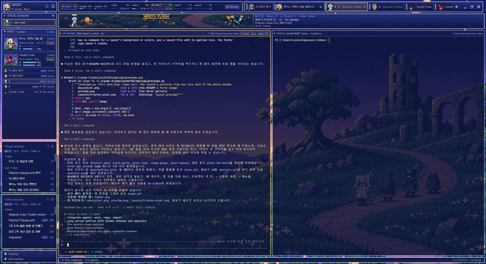

> Windows 10/11 only. The UI text is English.

## Frieren Pixel

### The party acts out what each agent is doing

The party reads each agent's screen every 1.5 seconds and sorts what it is doing into fifteen kinds of
work. Each kind has its own motion on the party card and its own move on the battle stage (below).
The pane header shows a battle line with the tool's detail, for example
`Stark unleashes a combo!  npm test`.

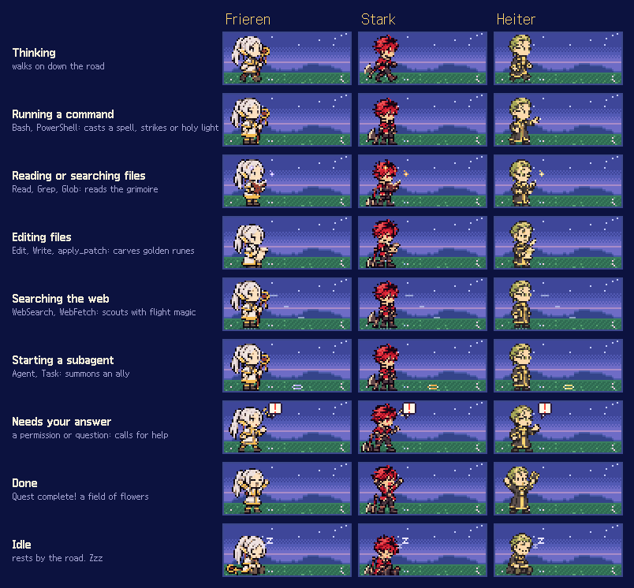

### The battle stage: the tab's party in one scene

Above the terminals, a stage shows the tab you're looking at: a strip of the background picture
itself (its pixel art at the sprites' pixel size, as wide as the window allows, up to 1024 px), with
one member per pane, up to four, each a different character. A gold ring marks the focused pane's
member. Beside it, a battle log tells what just happened and what each member is doing, and under it
each pane's slim header says the same in one line.

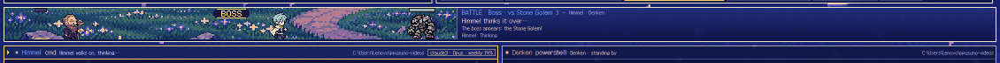

While any agent of the tab works, the party fights a long battle (40 to 60 seconds before it starts
over) in three waves: the background's monster, another monster, then the Stone Golem as the boss,
who gets enraged (`RAGE!`) halfway and strikes twice. Each member's turns go through the kinds of work
its agent did in the last five minutes, with a normal attack in between, so the battle tells what the
agent has been up to. New kinds join the next battle within a minute, without cutting off the one
that's playing.

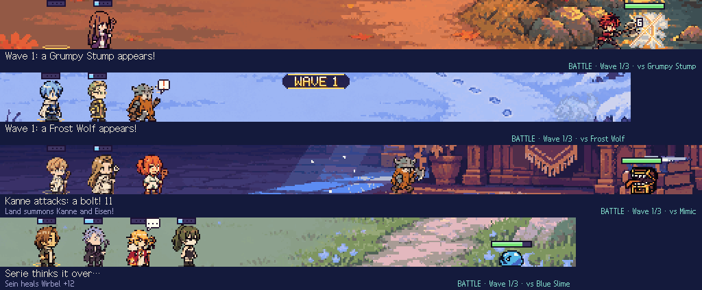

Every kind of work has its own turn:

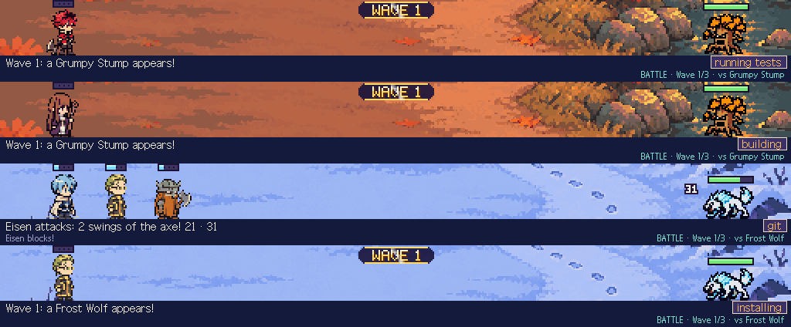

| The agent is… | Read from the screen | Its turn on the stage |
|---|---|---|
| thinking | no tool running | a normal attack, after a pause to think it over (`…`) or after gathering mana |
| running a command | `Bash`, `PowerShell`, `Ran …` | a normal attack (below) |
| running tests or a linter | `test`, `pytest`, `jest`, `lint`, `check` … | a combo: four quick hits, or a five-shot volley, `COMBO!` |
| building or rendering | `build`, `make`, `tsc`, `cargo`, `render`, `ffmpeg` … | hammers a blade at an anvil, `FORGED!`; the blade flies over and falls on the monster |
| using git | `git`, `gh` | plants the party's banner, `RALLY!`; everyone charges together |
| installing | `npm install`, `pip install`, `winget` … | drinks a potion, `ATK UP`, then a critical hit |
| deleting | `rm`, `Remove-Item`, `clean`, `prune` … | calls down a meteor storm, `BOOM!` |
| reading files | `Read`, `cat`, `Get-Content`, `Skill` | scans the monster for its weak point, `WEAK!`, then strikes it |
| searching | `Grep`, `Glob`, `Search`, `rg`, `ls` … | follows the trail with a magnifying glass, footprints behind, `FOUND!` |
| editing files | `Edit`, `Write`, `Update`, `apply_patch` | a rune circle erupts under the monster |
| planning | `Update Todos`, `TodoWrite`, `Plan` | unrolls a map, draws arrows on the ground, `TACTICS`: the next strike crits |
| waiting | `Monitor`, `sleep`, `hc wait`, `Wait-Job` … | stands guard with an hourglass, blocks the monster's attack, `COUNTER` |
| on the web | `WebSearch`, `WebFetch`, `curl` … | flies up and dives on the monster |
| making images or audio | `gen_image`, `tts`, `grok` … | conjures two illusions of itself; all three strike at once |
| starting subagents | `Agent`, `Task`, `Explore` | a summoning circle: another character (one not in the tab) joins the fight, one per subagent, up to two |

**Normal attacks** take turns, so no two in a row look the same: Stark, Eisen and Himmel slash once,
slash twice, leap in from above, or dash in; mages fire a bolt, two bolts, a bolt charged in a magic
circle, or Zoltraak; priests throw a holy orb, two orbs, a charged orb, or rain holy light and heal the
party.

**Special moves (필살기)**: every turn fills the member's **SP gauge** over its head. When it's full
(it blinks), and on the last blow of every wave, the member uses its special: the stage dims, the
move's name unfurls on a banner, and the screen flashes as the big hit lands.

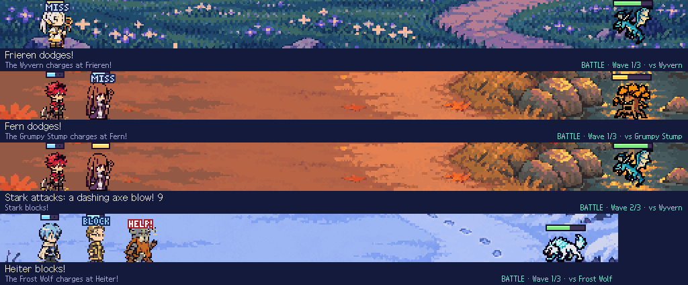

All sixteen at once, as stills: [docs/specials.png](docs/specials.png).

| Character | Special | What happens |
|---|---|---|
| Frieren | Zoltraak | a great magic circle, then a beam as thick as the monster |
| Fern | Zoltraak Barrage | a storm of a dozen bolts |
| Serie | Rain of Light | spears of light fall from the sky |
| Flamme | Hellfire | pillars of fire erupt under the monster |
| Denken | Tempest | a whirlwind swallows the monster |
| Lawine | Ice Lances | ice spikes burst out of the ground all the way to the monster |
| Kanne | Tidal Wave | a wave rolls across the stage and crashes |
| Methode | Binding Chains | chains bind the monster, then bolts |
| Wirbel | Thunderbolt | three bolts of lightning |
| Land | Mirror Army | four copies of Land appear and all fire |
| Ubel | Severing Cut | the monster is cut again and again |
| Stark | Sky Splitter | a leap into the sky and one blow straight down |
| Eisen | Earthshaker | the axe into the ground, rocks erupting up to the monster |
| Himmel | Hero's Flash | gone in a flash; the cuts open a moment later |
| Heiter | Holy Judgment | a pillar of light, and the party is healed |
| Sein | Sanctuary | a holy circle heals the party, then light rains down |

Every two turns the monster strikes back: a shot at someone, a charge across the stage at the front
member, or a blast at the whole party. Members block (warriors and priests), dodge, or take damage and
get healed by a priest. A member whose agent needs you calls `HELP!`. Damage numbers rise, the HP bar
drains, the last hit knocks the monster out and the party cheers; after the boss, `VICTORY!` and a
treasure chest. Both Claude Code's lines (`● Bash(npm test)`, `Reading 1 file…`, `⎿ $ cmd`) and
Codex's (`• Ran …`) are understood.

When nobody works, the stage shows a pastime that changes every 20 minutes, and a victory when an
agent is done:

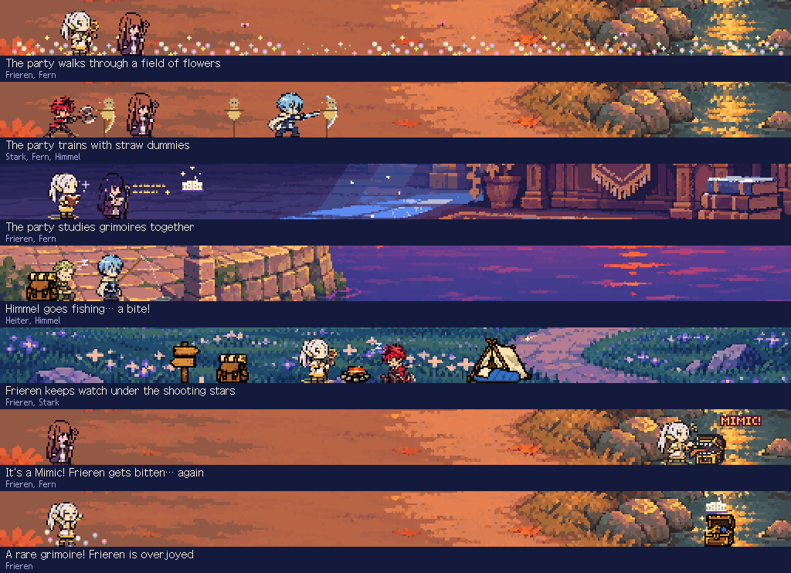

| The tab's agents… | The scene |
|---|---|
| all idle, by day | a meal around the cooking pot, a walk through a field of flowers with butterflies, training on straw dummies, studying grimoires, or fishing (by water: lake, snow, meadow) |
| all idle, 22:00 to 07:00 | asleep by the embers, or one keeps watch under shooting stars |
| one is done and none works | a treasure chest, a rare grimoire, or a mimic that bites (again) |

The monsters: Wyvern (Starry Night Road), Blue Slime (Spring Dawn Meadow), Will-o'-Wisp (Meteor
Shower), Frost Wolf (Northern Aurora), Grumpy Stump (Autumn Forest Road), Mimic (Mage Library),
Lake Serpent (Lakeside Town at Sunset) and the Stone Golem.

### Sixteen party members

Each member's attack has its own style and color: mages fire bolts, warriors slash, priests throw
holy light. Each also has a special move of its own (above).

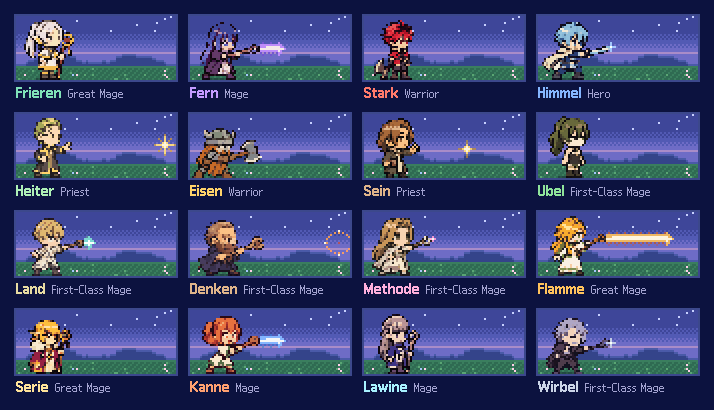

Characters are handed out in roster order, and each tab keeps its own. Rename a tab to `Fern`,
`Stark`, … to pick one. The pick is shared with Frieren Journey, so a tab keeps its character in both
layouts.

### A new scene every hour

Seven pixel-art scenes take turns as the background, one per hour. Click **Journey · Day N** in the
top-left corner to skip to the next one (or bind `pixel-chrome.next-scene` to a key), or hover it to
see the current scene's name. Terminals are 55% opaque, so the scene shows through softly and text
stays readable.

The whole look follows the scene: the frames and panel gradients, the accent, the terminal tint, the
party cards' little stages, the battle stage's strip and its monster. Every scene keeps the same
lightness, so text reads the same in all of them.


1. Starry Night Road
2. Spring Dawn Meadow
3. Meteor Shower
4. Northern Aurora
5. Autumn Forest Road
6. Mage Library
7. Lakeside Town at Sunset

The terminal is left empty in the animation above so each scene is easy to see.

### Also in Frieren Pixel

- **Party cards**, as tall as their 64px stage, for members who work, need you or are done (on top):
  the tab name and status (the motion while working: Casting, Testing, Forging, …), the member with
  account and model and a `Claude` / `Codex` tag, and **HP** (what's left of the 5-hour limit) and
  **MP** (what's left of the weekly limit) bars. Resting members fold to one line with their face,
  character and HP. Hover a card for its battle line. Agents that report no status to Herdr (a Claude
  Code background job) are listed too, their status read from the screen.
- **Pane headers**: one slim row: the character, the battle line with the tool's detail, the folder,
  the account, model and usage, and pixel buttons to split, zoom and close.
- **Small windows**: the usage bar shrinks and scrolls sideways, so the tabs and the window buttons
  always stay in view.
- **Which account to use next**: in the usage bar a ★ marks the Claude account and the Codex account
  with the most usage left (stale or logged-out readings don't count).

  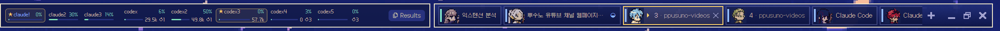
- **Tabs as inventory slots**, each with its member's pixel face and status. A tab you never named
  shows a name of its own, `3 · my-repo`: the title of the session it resumed, else its repo or folder,
  else its program (the tab itself isn't renamed; hover for where the name came from). A thin color bar
  beside each tab's face marks its project, the same color for every tab in the same repo.
- **The + menu** (`pixel-new-menu`) lists Claude Code and Codex once per account (`claude`, `claude2`,
  …), the one with the most usage left first, marked `most left`.
- **Spaces as destinations**: eight pixel place tiles (Royal Capital, Old Ruins, Flower Hill, Forest
  Camp, Rampart Watchtower, Town Street, Starlit Old Tree, Moonlit Castle) with the repo's branch and
  ahead/behind. With one space the panel shrinks to a single row, leaving room for the party; a second
  space brings back its old size.
- **Fold the sidebar** with the button in the top-left corner: it shrinks to a 64px rail.
  `Ctrl+Shift+B` hides it completely.
- **Pixel font everywhere**: [Galmuri](https://github.com/quiple/galmuri) (SIL OFL 1.1), which also
  covers Korean and Japanese.

## Frieren Journey

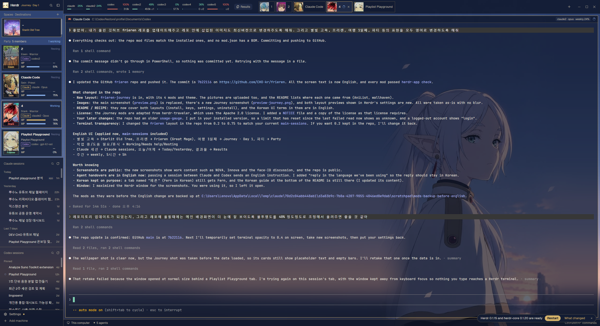

- **Party cards**: one card per agent, drawn as a member of Frieren's world (the same 16 characters).
  A card shows the portrait, the tab name and status, the resumed session's title (or "Fern · Mage"), a
  `Claude` / `Codex` tag with the account and model, and HP/MP bars.
- **Status effects** on the portrait: working = a turning magic circle with sparkles, needs help = a
  flashing `!`, resting = `z z z`, done = a flower.
- **Places for spaces**: each space gets one of eight places as a framed painting, plus a git summary
  across its terminals (uncommitted files, unpushed commits, repos without a remote).
- **Faces on tabs**: each tab shows its party member's face, framed in that character's color.
- **Look**: navy and gold theme (`frieren-journey`) with square gold frames. Terminals are 40% opaque,
  so the wallpaper shows through clearly. Fold the sidebar (`Ctrl+Shift+B`) and the party shrinks to a
  column of faces.

## In both layouts

- **Journey · Day N** in the top-left corner, counted from the day you first open either layout.
- **Session lists for Claude and Codex**: every session the Claude and Codex desktop apps saved, in
  the sidebar, grouped by date (Today, Yesterday, Last 7 days, …), with live status marks (working,
  needs you, done, idle) and `All · 7d · 30d · Older` filters with counts under the header. Click to
  resume in its folder. If a terminal already runs it, that terminal gets focus. A session still open
  in the desktop app is tagged `app` (Claude) or `open` (Codex, also when another terminal has it).
  Opening such a Claude session, or such a Codex thread with another account, asks first: continue (and
  stop typing in the other place), or open a copy that leaves the original alone. Copies of these
  sessions made in Herdr tabs, and sessions made in another terminal and reopened in a tab, are listed
  here too, with where they came from on hover.
- **Herdr sessions**: the Claude and Codex sessions started new in Herdr tabs, with every account
  (`claude`, `claude2`, …, `codex`, `codex2`, …), so they don't get lost among the app's. It finds them
  under the tabs' processes every 30 seconds and keeps them after the tab closes. `All · Claude ·
  Codex` filters; a click goes to the session's tab, or resumes it in a new one with the account that
  made it; right-click for another account, a copy, or to hide it.
- **Sessions sorted into your spaces** (optional, see [Customize](#customize)): with a `spaces.json`,
  every session in the three lists is sorted into one of your Herdr spaces by the words of its
  conversation (its title counts most) and by its folder. While one of those spaces is shown, each
  list keeps that space's sessions and any open in its tabs, and folds the ones that fit nowhere under
  `Not sorted`. The chip in each header (the space's name, or `All spaces`) switches between the two.
  Right-click → **Space** puts a session where you want it (`Sort by its words` undoes that). A click
  opens a session in its own space, and makes the space again if you closed it. Without `spaces.json`
  nothing changes: every session is listed and opens in the shown space.

  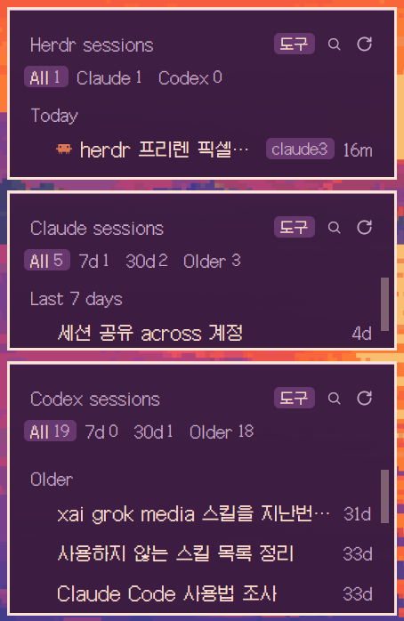

- **Remote Control for the main Claude account**: a session the Herdr sessions panel resumes with the
  plain `claude` account starts with `--remote-control` under its title, and a new `claude` from the
  `+` menu starts with Remote Control too (named `herdr-…` until Claude titles it after your first
  message), so both show in the Claude desktop app's list as connected. Sessions from the desktop app
  are connected already. `claude2`, `claude3`, … are other logins and are left alone.
- **Switch accounts or agents per session**: right-click a session to continue it with another
  account, or hand it to the other agent (Claude → Codex, Codex → Claude). Handed-over pairs are
  remembered (`⇄`), and later moves pass on only the new turns.
- **Session search** (`Ctrl+Shift+S`): a popup that searches every session by title, folder and space
  (each row says its space), with All / Herdr / Claude / Codex filters (one per list) and keyboard
  navigation.
- **Usage gauges**: one chip per account in the top bar with its weekly or 5-hour usage, colored by how
  full it is (blue → yellow at 70% → red at 90%). Codex chips also show credits and free reset passes.
  Hover for every window and its reset time. Click to refresh.
- **Account on every pane**: each pane header shows `claude2 · Opus 5.5 · weekly 3%`, also for agents
  you typed by hand into a shell (read from the running process).
- **Results panel** (`Ctrl+Shift+R` or the `Results` button): the newest files in the focused terminal's
  folder, with image and video thumbnails, a preview window, and an "Attach to agent" button.
- **Smart paste** (`Ctrl+V`): pastes text and copied files. A screenshot on the clipboard is saved as a
  PNG and attached, so Claude Code and Codex pick it up.

## Requirements

| What | Why |
|---|---|
| Windows 10/11, Windows PowerShell 5.1 | the mods use PowerShell, `.cmd` wrappers and Windows APIs |
| [Herdr](https://herdr.dev) desktop app with `hc` on PATH | the app itself; Frieren Pixel reads agent screens with `hc read` |
| Python 3.10+ on PATH, with [Pillow](https://pypi.org/project/pillow/) | usage, session lists, thumbnails, clipboard images |
| Claude Code at `~/.local/bin/claude.exe` and the Claude desktop app | the Claude session list |
| Codex desktop app (`%LOCALAPPDATA%\OpenAI\Codex\bin\…\codex.exe`) | the Codex session list and gauges |
| `git` on PATH | the git summary under each space |
| `ffmpeg` (optional) | video thumbnails in the results panel |
| numpy, fontTools and scipy (optional) | only to rebuild the pixel sprite fonts (`mods/pixel-party/build`) |

```powershell
python -m pip install pillow
```

## Install

### Ask your agent (easiest)

In a Herdr terminal, ask Claude Code or Codex:

```
Add the Herdr layouts from https://github.com/CHO-kr/frieren
```

Herdr's own instructions (`~/.config/herdr-app/AGENTS.md`) tell the agent how to read the recipe,
copy the files without overwriting yours, check every mod and switch to the layout.

### By hand

```powershell
git clone https://github.com/CHO-kr/frieren "$env:TEMP\frieren"
$src = "$env:TEMP\frieren"; $h = "$HOME\.config\herdr-app"

# Stop if a name is already taken (rename the new one first)
$taken = @(Get-ChildItem "$src\mods" -Directory | Where-Object { Test-Path "$h\mods\$($_.Name)" } | ForEach-Object { "mods\$($_.Name)" }) +
  @(Get-ChildItem "$src\layouts", "$src\themes", "$src\backgrounds" -File | ForEach-Object { "$($_.Directory.Name)\$($_.Name)" } | Where-Object { Test-Path "$h\$_" })
if ($taken) { "Already there, rename before copying: $($taken -join ', ')" } else {
  foreach ($d in 'layouts','themes','backgrounds','mods') { New-Item -ItemType Directory -Force "$h\$d" | Out-Null }
  foreach ($m in Get-ChildItem "$src\mods" -Directory) {
    # mod.json first, so Herdr doesn't dock the mod into the layout you're looking at
    New-Item -ItemType Directory "$h\mods\$($m.Name)" | Out-Null
    Copy-Item "$($m.FullName)\mod.json" "$h\mods\$($m.Name)"
    Copy-Item "$($m.FullName)\*" "$h\mods\$($m.Name)" -Exclude mod.json -Recurse
  }
  Copy-Item "$src\layouts\*" "$h\layouts"
  Copy-Item "$src\themes\*" "$h\themes"
  Copy-Item "$src\backgrounds\*" "$h\backgrounds"
}
```

Then **merge** the keys into your `~/.config/herdr-app/keys.json`. Don't replace the file, and check
that you don't already use these keys:

```json
{
  "layout:frieren-journey": {
    "ctrl-shift-s": "mod.open:session-search",
    "ctrl-shift-r": "layout.toggle:results"
  },
  "layout:frieren-pixel": {
    "ctrl-shift-s": "mod.open:session-search",
    "ctrl-shift-r": "layout.toggle:results"
  },
  "terminal": {
    "ctrl-v": "smart-paste.paste"
  }
}
```

Check the mods and switch to a layout:

```powershell
foreach ($m in Get-ChildItem "$env:TEMP\frieren\mods" -Directory) { herdr-app check "$HOME\.config\herdr-app\mods\$($m.Name)" }
herdr-app do layout.switch --name frieren-pixel     # or frieren-journey
```

Install all nineteen mods, even if you want only one layout. Nine tool mods collect usage, session
lists and accounts. The four `journey-*` mods draw Frieren Journey, and the six `pixel-*` mods draw
Frieren Pixel. The pixel mods also read `journey-party/jobs.json`, `journey-spaces/places.json` and
`pane-account`.

## Quick start

| Do this | What happens |
|---|---|
| `Ctrl+Shift+L` | cycle layouts (yours, Frieren Pixel, Frieren Journey) |
| Click a party card | focus that agent's terminal |
| Rename a tab to `Fern`, `Stark`, … | that tab's agent becomes that character |
| Click **Journey · Day N** (Frieren Pixel) | skip to the next background scene (its colors and monster come with it) |
| Click a session in **Herdr sessions** / **Claude sessions** / **Codex sessions** | resume it in a new tab in its folder, or focus it if it's already open |
| Right-click a session | continue with another account, hand over to the other agent, hide it, or move it to another space |
| Click the space chip in a list's header | switch between the shown space's sessions and every space's |
| `Ctrl+Shift+S` | search every session. `Tab` switches filter, `↑`/`↓` move, `Enter` opens, `Esc` closes |
| Click / hover a usage chip | refresh now / see every window, its reset time, plan and login |
| Right-click a Codex chip | spend one free reset pass (asks first; it can't be undone) |
| `Ctrl+Shift+R` or `Results` | open the results panel for the focused terminal's folder |
| `Ctrl+V` in a terminal | paste text, files, or a screenshot as an attachment |
| `Ctrl+Shift+B` | hide the sidebar (in Frieren Journey: fold it to a rail of faces) |

### More than one account

The gauges and menus find extra accounts from small wrapper scripts in `~/.local/bin`:

```bat
@echo off
rem ~/.local/bin/claude2.cmd: Claude Code with a second account
set "CLAUDE_CONFIG_DIR=%USERPROFILE%\.claude-2"
"%~dp0claude.exe" %*
```

```bat
@echo off
rem ~/.local/bin/codex2.cmd: Codex with a second account in ~/.local/share/codex-accounts/codex2
setlocal
set "CODEX_HOME=%~dp0..\share\codex-accounts\codex2"
call codex --no-daemon %*
exit /b %errorlevel%
```

Log in once with each wrapper (`claude2`, `codex2`), then click the gauges to refresh.

## Customize

- **Scenes (Frieren Pixel)**: the interval is `SCENE_EVERY` (one hour) in `mods/pixel-chrome/main.js`;
  the scenes and their palettes are `mods/pixel-chrome/scenes.js`, made by
  `mods/pixel-party/build/palettes.py`. Herdr has no command to change a background or colors, so the
  brand row rewrites `layouts/frieren-pixel.json` when the scene changes: the `background.image` line,
  the root `colors` line, and the blocks' frame and gradient colors (colors you picked yourself are left
  alone). Set `background.image` to a picture of your own and the rotation stops. To skip scenes from
  the keyboard, add `"ctrl-alt-n": "pixel-chrome.next-scene"` to `keys.json`.
- **The battle stage**: each scene's strip, monster and anchor are in
  `mods/pixel-party/build/stage_art.py`, which also draws the monster, effect and prop fonts; the
  special moves, banners and SP gauge are drawn by `build/special_art.py` (whose `SPECIAL` table names
  each character's move). Every turn, wave, special, pastime and victory is in
  `mods/pixel-pane/plan.js` (`SP_MAX`, the turns per wave), how long a battle remembers the kinds of
  work and how often it re-plans in `mods/pixel-pane/main.js` (`KIND_MS`, `REPLAN_MS`), and which kind
  of work a screen line is (`RULES`, `COMMANDS`) in `classify` of `lib.js`. `build/stage_dump.mjs` + `build/stage_preview.py`
  draw the stage as GIFs without Herdr, to try a change.
- **Wallpaper (Frieren Journey)**: replace `backgrounds/frieren.jpg` (same name), or change
  `background.image` in `layouts/frieren-journey.json`.
- **Terminal see-through**: `terminal_opacity` in each layout (`0.55` in Pixel, `0.4` in Journey; `1`
  is solid, `0.2` shows the background clearly).
- **Usage bar width**: in Pixel the `usage` and `tabs` blocks share the top bar `1 : 1.3`, so a small
  window shrinks both and the usage chips scroll. In Journey the `usage` block is a fixed `818px`
  (2 Claude and 5 Codex). Allow about 78px per Claude chip, 104px per Codex chip and 90px for the button.
- **Colors**: `themes/frieren-pixel.json` and `themes/frieren-journey.json`. The alpha in `chrome`,
  `surface`, `popover` and `background` controls how translucent each part is. In Pixel the scene's
  palette (`colors` in the layout) wins over the theme while the scenes rotate.
- **Who plays whom**: characters are handed out in roster order and each tab keeps its own.
  Name a tab after a character, or map tab names in `mods/journey-party/jobs.json`:
  `{ "api": "stark", "docs": "fern" }`.
- **Which place a space is**: picked from the space's name. Pin one in
  `mods/journey-spaces/places.json`: `{ "my-project": "camp" }` (`capital`, `ruins`, `meadow`, `camp`,
  `tower`, `street`, `tree`, `moon`).
- **Sprites**: `mods/pixel-party/build/README.txt` explains how the sprite fonts are built from the
  cut sprites in `build/spr/`.
- **Spaces for the session lists**: copy `mods/herdr-sessions/spaces.example.json` to
  `%LOCALAPPDATA%\herdr-sessions\spaces.json` and make it yours. Each space's `name` is the name of a
  Herdr space; `words` is a case-insensitive regular expression of what its work talks about, and
  `weight` how much one of those words counts (raise it for a space whose words are rare); `folder` is
  where the space is made again if you closed it, and `about` the note in the right-click menu.
  `folders` sends a project folder (and everything under it) to a space; it decides alone when a
  session has fewer than `enough` weighted words. Folders may start with `~`. The lists sort again
  every minute; changing `words` counts every transcript again once.

  ```json
  { "key": "work", "name": "Work", "folder": "~", "about": "Clients and mail",
    "weight": 3, "words": "client|contract|invoice|outlook" }
  ```

  To turn Remote Control off, remove `REMOTE` from `mods/pixel-new-menu/accounts.js` and the
  `--remote-control` line from `claudeArgv` in `mods/herdr-sessions/main.js`. Do that if your plain
  `claude` is signed in to a different account than the Claude desktop app.

## Privacy and safety

These mods are trusted code that runs on your machine. Before installing, know that they:

- **run programs**: `python`, `powershell`, `codex.exe app-server`, `hc` (including `hc read` on
  each agent's terminal, to see which tool it runs, and `hc ls` / `hc get` to find the sessions Herdr
  tabs run), `explorer`, and `git status` / `git rev-parse` in each terminal's folder.
- **read files outside their folder**: your Claude and Codex homes, the desktop apps' session data,
  and each account's login credentials (to read usage). The Herdr sessions panel also lists the
  processes under Herdr's terminals and asks Windows which of them holds a Codex thread's lock file.
  With a `spaces.json`, `spaces.py` reads the sessions' transcripts (what you and the agent wrote, not
  tool output) to count your space words; only the counts are kept.
- **use the network**: each Claude account's OAuth access token goes only to `api.anthropic.com`
  (usage and profile; never printed, stored or refreshed), and the Codex app-server talks to OpenAI.
  Nothing else goes out. What the party reads from agent screens stays on your machine. Claude
  sessions started with Remote Control (see above) are reachable from your Claude account, as
  Claude Code's own `--remote-control` makes them.
- **write** caches to `%LOCALAPPDATA%\herdr-sessions` (including `herdr-made.json`, the sessions
  started in Herdr, and `space-cache.json` / `space-map.json`, the space word counts and where each
  session goes), `%LOCALAPPDATA%\herdr-claude-sessions` and `~/.config/herdr-app/.thumbs`. Nothing
  writes to Claude's or Codex's own files. Frieren Pixel also rewrites the background and color lines of its
  own layout file once an hour.

Spending a Codex reset pass is permanent. It always asks for confirmation first.

## Known limits

- Windows only.
- `Ctrl+V` smart paste works only while one of these layouts is shown. In other layouts that binding
  does nothing: use `Ctrl+Shift+V`, or remove the `terminal` → `ctrl-v` key.
- The Claude list needs the Claude desktop app. Without the Codex app's `state_5.sqlite`, the Codex list
  shows a read error.
- The Herdr sessions panel looks at the tabs every 30 seconds, so a session whose tab closes sooner
  than that may not be listed.
- Space sorting goes by words, so a session about several things can land in the wrong space:
  right-click → Space moves it. The first sort reads every transcript once (about half a minute for a
  few hundred sessions); after that only what was added.
- The Claude usage endpoint rate-limits frequent polling. The gauges read every 5 minutes and wait
  out `Retry-After` (`wait`).
- An account whose usage has no 5-hour window shows HP as `—`.
- The motions come from reading the agent's screen, so a tool the screen doesn't show reads as thinking.
- Herdr keeps a loaded font in memory. After rebuilding the sprite fonts, raise `FONT_VERSION`
  (see `mods/pixel-party/build/README.txt`).

## Uninstall

Delete `layouts/frieren-*`, `themes/frieren-*`, `backgrounds/frieren.jpg`,
`backgrounds/frieren-pixel-*.png`, the nineteen folders in `mods/` (`usage-gauge`,
`herdr-sessions`, `claude-sessions`, `codex-sessions`, `session-menu`, `session-search`, `pane-account`, `results-panel`,
`smart-paste`, `journey-chrome`, `journey-spaces`, `journey-party`, `journey-tabs`, `pixel-chrome`,
`pixel-spaces`, `pixel-party`, `pixel-tabs`, `pixel-pane`, `pixel-new-menu`) and the keys above. Switch back with
`Ctrl+Shift+L`.

## What's in this repo

```
layouts/frieren-pixel.json      Frieren Pixel (and frieren-pixel.png, its settings preview)
layouts/frieren-journey.json    Frieren Journey (and frieren-journey.png)
themes/                         frieren-pixel (deep navy and cream) and frieren-journey (navy and gold)
backgrounds/                    seven 2560×1440 pixel scenes and the Journey wallpaper
mods/pixel-*                    the six Frieren Pixel mods: sprite, monster, effect, special and prop fonts, faces,
                                tiles, icons, Galmuri fonts, the scenes' palettes (pixel-chrome/scenes.js),
                                the stage strips (pixel-party/scenes/) and card stages (pixel-party/backdrops/)
mods/pixel-party/build/         scripts and cut sprites that build all of the above
mods/journey-*                  the four Frieren Journey mods (with their pictures)
mods/ (the rest)                nine tool mods both layouts use (session lists, usage, accounts, …);
                                herdr-sessions/spaces.py sorts sessions into spaces (spaces.example.json)
keys.json                       the key bindings to merge
RECIPE.md                       the full build brief (exact sizes, colors, behavior)
preview.png                     the picture the Herdr gallery shows (Frieren Pixel)
docs/                           the screenshots and animations in this README
NOTICE, LICENSES/               attribution and license text for the derived code and the fonts
```

Want to rebuild it from scratch or change how it works? [`RECIPE.md`](RECIPE.md) describes every part
in detail.

## Credits

*Frieren: Beyond Journey's End* and its characters belong to their respective owners. None of the
pictures below are the author's own art, and none are covered by a license in this repository. They are
here for personal desktop use; to share a layout publicly, consider swapping in your own pictures. If
you hold the rights to one of them and want it removed, please open an issue.

| File | Source |
|---|---|
| `mods/pixel-party/build/spr/*.npz`, `mods/pixel-party/fonts/FrierenDot5-<name>.ttf`, `mods/pixel-party/faces/*.png` | pixel sprites cut from pose sheets made with OpenAI image generation (through Codex; the prompts are in `build/gen_all.ps1`), then grid-snapped and animated by the build scripts |
| `mods/pixel-party/build/spr_scene/*.npz`, `mods/pixel-party/fonts/FrierenDot5-monsters.ttf`, `-props.ttf` | monsters and camp props cut from two sheets made with OpenAI image generation (through Codex; the prompts are in `build/gen_scene.ps1`), halved and animated by `build/stage_art.py` |
| `backgrounds/frieren-pixel-*.png`, `mods/pixel-spaces/art/*.png`, `mods/pixel-party/scenes/*.png` | made with OpenAI image generation (through Codex), then reduced to a 64-color pixel grid; the stage strips are 512×36 cuts of the backgrounds at their art resolution |
| `backgrounds/frieren.jpg` | composed from a Frieren portrait found on Pinterest (artist unknown) |
| `mods/journey-party/cards/*.png`, `faces/*.png` | character images from [AniList](https://anilist.co/anime/154587) (anime 154587), resized; faces are square crops |
| `mods/journey-spaces/art/capital.jpg` | [wallhaven x6kxyd](https://wallhaven.cc/w/x6kxyd) |
| `mods/journey-spaces/art/ruins.jpg` | [wallhaven o5zrj7](https://wallhaven.cc/w/o5zrj7) |
| `mods/journey-spaces/art/meadow.jpg` | [wallhaven gw5ypd](https://wallhaven.cc/w/gw5ypd) |
| `mods/journey-spaces/art/camp.jpg` | [wallhaven 2yw1qx](https://wallhaven.cc/w/2yw1qx) |
| `mods/journey-spaces/art/tower.jpg` | [wallhaven e8vdp8](https://wallhaven.cc/w/e8vdp8) |
| `mods/journey-spaces/art/street.jpg` | [wallhaven po3djp](https://wallhaven.cc/w/po3djp) |
| `mods/journey-spaces/art/tree.jpg` | [wallhaven gpl8d3](https://wallhaven.cc/w/gpl8d3) |
| `mods/journey-spaces/art/moon.jpg` | [wallhaven 9omppk](https://wallhaven.cc/w/9omppk) |

The magic effects, battle effects (numbers, the anvil, banner, potion, meteors, map, hourglass, fishing
rod, training dummy and the rest), flames, steam, speech bubbles, stage backdrops and pixel icons are
drawn by code for Frieren Pixel (`mods/pixel-party/build/anim.py`, `stage_art.py`, `backdrop.py`,
`assets.py`; `FrierenDot5-fx.ttf`), and so are the special moves, banners and SP gauge
(`build/special_art.py`; `FrierenDot5-special.ttf`). The magic circle, sparkle, grimoire and
quill icons were drawn for Frieren Journey. The pixel font is [Galmuri](https://github.com/quiple/galmuri)
by Lee Minseo (quiple), under the SIL Open Font License 1.1 (`LICENSES/OFL-1.1-Galmuri.txt`). Some mods
are modified copies of Apache-2.0 licensed code; [`NOTICE`](NOTICE) lists them, and the license text is
in `LICENSES/`.

---

## 한국어 안내

[Herdr](https://herdr.dev) 데스크톱 앱용 Windows 레이아웃 두 개예요. Claude Code와 Codex를 계정 여러
개로 나란히 쓰기 좋게 만들었고, 프리렌 세계의 여행 파티처럼 꾸몄어요. 화면 글자는 영어예요.
설정 → Look → Layout에서 고르거나 `Ctrl+Shift+L`로 바꿔요.

### Frieren Pixel (픽셀 도트, 새로 추가)

- **일하는 대로 움직이는 캐릭터:** 에이전트마다 픽셀 캐릭터가 붙고, 지금 쓰는 도구에 따라 동작이
  바뀌어요. 명령 실행은 마법·검격·성스러운 빛, 파일 읽기는 마도서, 편집은 룬 새기기, 웹 검색은
  비행 마법, 서브에이전트는 소환이에요. 답을 기다리면 `!`, 끝나면 꽃밭에서 뛰고, 쉬면 `Zzz`예요.
- **창 헤더의 장면:** 배경 그림에서 잘라 낸 가로 띠 위에 탭의 창(pane)마다 캐릭터가 모여요(최대 4명).
  누가 일하면 그 배경의 몬스터와 함께 싸우고, 마법·검기가 몬스터까지 날아가 맞으면 몬스터가 번쩍여요.
  3명 이상이면 돌 골렘이 나와요. 끝나면 보물상자, 모두 쉬면 캠프에서 같이 밥을 먹고(낮), 밤(22시~7시)에는
  모닥불 옆에서 같이 자요. 창이 여러 개면 이 창의 캐릭터 발밑에 금색 고리가 생겨요.
- **캐릭터 16명:** 마법사, 전사, 성직자가 저마다 다른 색과 모양의 공격을 써요.
- **1시간마다 바뀌는 배경 7장:** 별밤 길, 봄 새벽 꽃밭, 유성우, 북쪽 오로라, 가을 숲길, 마법 도서관,
  노을 진 호숫가 마을. 테두리·패널·강조색·터미널 색·몬스터까지 배경에 맞춰 바뀌어요. 왼쪽 위
  **Journey · Day N**을 누르면 다음 배경으로 넘어가요.
- **작은 창에서도:** 사용량 막대가 줄어들고 옆으로 넘겨 볼 수 있어서, 탭과 창 버튼(최소화·최대화·닫기)이
  항상 보여요. 파티 카드는 HP·MP 위를 두 줄로 줄였어요.
- **픽셀 화면:** 탭은 인벤토리 칸, 스페이스는 픽셀 여행지 그림이에요. 사이드바는 64px로 접을 수
  있고, 글꼴은 갈무리(Galmuri)예요.

### 두 레이아웃 공통

- **세션 목록:** 왼쪽에 Claude·Codex 세션이 날짜별로 정리돼요. 클릭하면 이어서 열리고,
  우클릭하면 다른 계정이나 다른 에이전트로 넘길 수 있어요.
- **스페이스별 세션 정리(선택):** `spaces.json`을 두면 세션마다 대화 내용과 폴더를 보고 Herdr
  스페이스(업무·프로젝트·도구 등)에 나눠 담아요. 지금 보이는 스페이스의 세션만 목록에 나오고, 어디에도
  안 맞는 세션은 `Not sorted` 아래에 접혀요. 목록 머리의 칩을 누르면 `All spaces`로 전부 보여요.
  우클릭 → Space로 직접 옮길 수 있고, 세션을 누르면 그 세션의 스페이스에서 열려요.
  `spaces.json`이 없으면 예전처럼 전부 보여요. ([그림](docs/spaces.png): 도구 스페이스를 보는 중이라 세 목록 머리에
  `도구` 칩이 있고, 도구 세션만 나와요.)
- **데스크톱 앱에서도 이어 하기:** 기본 `claude` 계정으로 Herdr에서 이어 열거나 새로 연 세션은
  Remote Control로 시작해서 Claude 데스크톱 앱 목록에도 떠요.
- **세션 찾기:** `Ctrl+Shift+S`로 모든 세션을 제목·폴더·스페이스 이름으로 검색해요.
- **사용량과 계정 표시:** 위쪽 막대에 계정별 사용량이 보이고, 창마다 어떤 계정과 모델로 돌고 있는지
  표시돼요. 카드의 HP는 5시간 한도, MP는 주간 한도에서 남은 양이에요.
- **결과물 패널:** `Ctrl+Shift+R`로 지금 폴더의 최신 파일을 미리보기와 함께 열어요.
- **스크린샷 붙여넣기:** `Ctrl+V`로 붙여 넣으면 첨부 파일로 들어가요.

설치는 Herdr 터미널에서 에이전트에게
"https://github.com/CHO-kr/frieren 레이아웃 추가해줘"라고 하면 돼요. 직접 설치하려면 위의
[By hand](#by-hand)를 따라 하세요.
