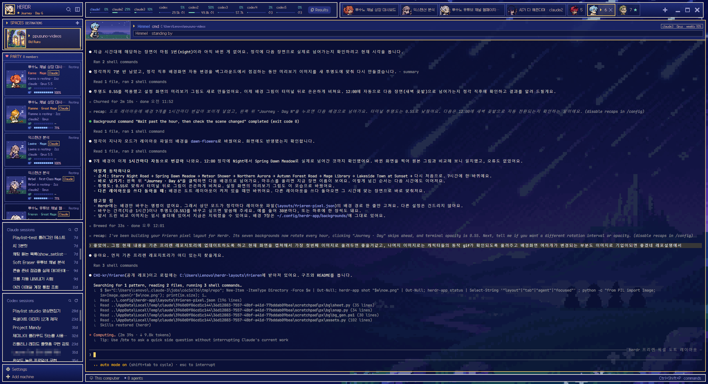
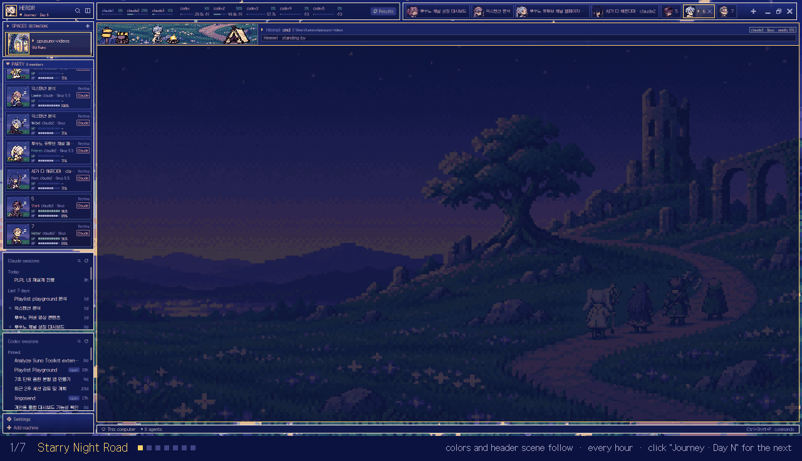

# Frieren: Herdr layouts

Two Windows layouts for the [Herdr](https://herdr.dev) desktop app, made for running several
**Claude Code** and **Codex** accounts side by side, dressed as a fantasy party from *Frieren*:

- **Frieren Pixel** (`frieren-pixel`, new): 16-bit pixel art. Every agent is a little pixel party
  member who acts out what the agent is doing right now. The background scene changes every hour.
- **Frieren Journey** (`frieren-journey`): painted portraits and a Frieren wallpaper behind
  translucent terminals.

Both share the same tools underneath: every saved Claude and Codex session one click away, every
account's plan usage in the top bar, and the account and model on every pane. Pick one in
**Settings → Look → Layout**, or cycle with `Ctrl+Shift+L`.



> Windows 10/11 only. The UI text is English.

## Frieren Pixel

### The party acts out what each agent is doing

The party reads each agent's screen every 1.5 seconds. When the agent starts a tool, its party
member switches to that tool's motion, both on the card in the sidebar and on a wider stage in the
pane header. The header also shows a battle line with the tool's detail, for example
`Frieren casts a spell!  npm test`.


| The agent is… | Tools it reads from the screen | The party member… |
|---|---|---|
| thinking | no tool running, or a finished tool group | walks on down the road |
| running a command | `Bash`, `PowerShell`, `Shell`, `Run`, `Monitor` | casts a spell, strikes, or casts holy light |
| reading or searching | `Read`, `Grep`, `Glob`, `Search`, `List`, `Skill` | reads the grimoire |
| editing files | `Edit`, `Write`, `Update`, `Create`, `apply_patch` | carves golden runes in the air |
| on the web | `WebSearch`, `WebFetch`, `Fetch`, browsing | scouts with flight magic |
| starting a subagent | `Agent`, `Task`, `Explore`, `Plan` | summons an ally |
| waiting for you | Herdr marks it blocked (a permission or a question) | calls for help with a `!` |
| done | Herdr marks it done | Quest complete! jumps in a field of flowers |
| idle | Herdr marks it idle | rests by the road, `Zzz` |

Both Claude Code's lines (`● Bash(npm test)`, `Reading 1 file…`, `⎿ $ cmd`) and Codex's (`• Ran …`)
are understood.

### Sixteen party members

Each member's attack has its own style and color: mages fire bolts, warriors slash, priests throw
holy light.


Characters are handed out in roster order, and each tab keeps its own. Rename a tab to `Fern`,
`Stark`, … to pick one. The pick is shared with Frieren Journey, so a tab keeps its character in both
layouts.

### A new scene every hour

Seven pixel-art scenes take turns as the background, one per hour. Click **Journey · Day N** in the
top-left corner to skip to the next one, or hover it to see the current scene's name. Terminals are
55% opaque, so the scene shows through softly and text stays readable.



1. Starry Night Road
2. Spring Dawn Meadow
3. Meteor Shower
4. Northern Aurora
5. Autumn Forest Road
6. Mage Library
7. Lakeside Town at Sunset

The terminal is left empty in the animation above so each scene is easy to see.

### Also in Frieren Pixel

- **Party cards**: the member on a small stage, `name · role`, a `Claude` / `Codex` tag, status
  (Acting, Needs help, Done, Resting), account and model, and **HP** (what's left of the 5-hour limit)
  and **MP** (what's left of the weekly limit) bars.
- **Pane headers**: the member's stage, the battle line, the folder, the account, model and usage, and
  pixel buttons to split, zoom and close.
- **Tabs as inventory slots**, each with its member's pixel face and status.
- **Spaces as destinations**: eight pixel place tiles (Royal Capital, Old Ruins, Flower Hill, Forest
  Camp, Rampart Watchtower, Town Street, Starlit Old Tree, Moonlit Castle) with the repo's branch and
  ahead/behind.
- **Fold the sidebar** with the button in the top-left corner: it shrinks to a 64px rail.
  `Ctrl+Shift+B` hides it completely.
- **Pixel font everywhere**: [Galmuri](https://github.com/quiple/galmuri) (SIL OFL 1.1), which also
  covers Korean and Japanese.

## Frieren Journey


- **Party cards**: one card per agent, drawn as a member of Frieren's world (the same 16 characters).
  A card shows the portrait, the tab name and status, the resumed session's title (or "Fern · Mage"), a
  `Claude` / `Codex` tag with the account and model, and HP/MP bars.
- **Status effects** on the portrait: working = a turning magic circle with sparkles, needs help = a
  flashing `!`, resting = `z z z`, done = a flower.
- **Places for spaces**: each space gets one of eight places as a framed painting, plus a git summary
  across its terminals (uncommitted files, unpushed commits, repos without a remote).
- **Faces on tabs**: each tab shows its party member's face, framed in that character's color.
- **Look**: navy and gold theme (`frieren-journey`) with square gold frames. Terminals are 40% opaque,
  so the wallpaper shows through clearly. Fold the sidebar (`Ctrl+Shift+B`) and the party shrinks to a
  column of faces.

## In both layouts

- **Journey · Day N** in the top-left corner, counted from the day you first open either layout.
- **Session lists for Claude and Codex**: every saved session in the sidebar, grouped by date
  (Today, Yesterday, Last 7 days, …), with live status marks (working, needs you, done, idle).
  Click to resume in its folder. If a terminal already runs it, that terminal gets focus.
- **Switch accounts or agents per session**: right-click a session to continue it with another
  account, or hand it to the other agent (Claude → Codex, Codex → Claude). Handed-over pairs are
  remembered (`⇄`), and later moves pass on only the new turns.
- **Session search** (`Ctrl+Shift+S`): a popup that searches every session by title and folder, with
  All / Claude / Codex filters and keyboard navigation.
- **Usage gauges**: one chip per account in the top bar with its weekly or 5-hour usage, colored by how
  full it is (blue → yellow at 70% → red at 90%). Codex chips also show credits and free reset passes.
  Hover for every window and its reset time. Click to refresh.
- **Account on every pane**: each pane header shows `claude2 · Opus 5.5 · weekly 3%`, also for agents
  you typed by hand into a shell (read from the running process).
- **Results panel** (`Ctrl+Shift+R` or the `Results` button): the newest files in the focused terminal's
  folder, with image and video thumbnails, a preview window, and an "Attach to agent" button.
- **Smart paste** (`Ctrl+V`): pastes text and copied files. A screenshot on the clipboard is saved as a
  PNG and attached, so Claude Code and Codex pick it up.

## Requirements

| What | Why |
|---|---|
| Windows 10/11, Windows PowerShell 5.1 | the mods use PowerShell, `.cmd` wrappers and Windows APIs |
| [Herdr](https://herdr.dev) desktop app with `hc` on PATH | the app itself; Frieren Pixel reads agent screens with `hc read` |
| Python 3.10+ on PATH, with [Pillow](https://pypi.org/project/pillow/) | usage, session lists, thumbnails, clipboard images |
| Claude Code at `~/.local/bin/claude.exe` and the Claude desktop app | the Claude session list |
| Codex desktop app (`%LOCALAPPDATA%\OpenAI\Codex\bin\…\codex.exe`) | the Codex session list and gauges |
| `git` on PATH | the git summary under each space |
| `ffmpeg` (optional) | video thumbnails in the results panel |
| numpy, fontTools and scipy (optional) | only to rebuild the pixel sprite fonts (`mods/pixel-party/build`) |

```powershell
python -m pip install pillow
```

## Install

### Ask your agent (easiest)

In a Herdr terminal, ask Claude Code or Codex:

```
Add the Herdr layouts from https://github.com/CHO-kr/frieren
```

Herdr's own instructions (`~/.config/herdr-app/AGENTS.md`) tell the agent how to read the recipe,
copy the files without overwriting yours, check every mod and switch to the layout.

### By hand

```powershell
git clone https://github.com/CHO-kr/frieren "$env:TEMP\frieren"
$src = "$env:TEMP\frieren"; $h = "$HOME\.config\herdr-app"

# Stop if a name is already taken (rename the new one first)
$taken = @(Get-ChildItem "$src\mods" -Directory | Where-Object { Test-Path "$h\mods\$($_.Name)" } | ForEach-Object { "mods\$($_.Name)" }) +
  @(Get-ChildItem "$src\layouts", "$src\themes", "$src\backgrounds" -File | ForEach-Object { "$($_.Directory.Name)\$($_.Name)" } | Where-Object { Test-Path "$h\$_" })
if ($taken) { "Already there, rename before copying: $($taken -join ', ')" } else {
  foreach ($d in 'layouts','themes','backgrounds','mods') { New-Item -ItemType Directory -Force "$h\$d" | Out-Null }
  foreach ($m in Get-ChildItem "$src\mods" -Directory) {
    # mod.json first, so Herdr doesn't dock the mod into the layout you're looking at
    New-Item -ItemType Directory "$h\mods\$($m.Name)" | Out-Null
    Copy-Item "$($m.FullName)\mod.json" "$h\mods\$($m.Name)"
    Copy-Item "$($m.FullName)\*" "$h\mods\$($m.Name)" -Exclude mod.json -Recurse
  }
  Copy-Item "$src\layouts\*" "$h\layouts"
  Copy-Item "$src\themes\*" "$h\themes"
  Copy-Item "$src\backgrounds\*" "$h\backgrounds"
}
```

Then **merge** the keys into your `~/.config/herdr-app/keys.json`. Don't replace the file, and check
that you don't already use these keys:

```json
{
  "layout:frieren-journey": {
    "ctrl-shift-s": "mod.open:session-search",
    "ctrl-shift-r": "layout.toggle:results"
  },
  "layout:frieren-pixel": {
    "ctrl-shift-s": "mod.open:session-search",
    "ctrl-shift-r": "layout.toggle:results"
  },
  "terminal": {
    "ctrl-v": "smart-paste.paste"
  }
}
```

Check the mods and switch to a layout:

```powershell
foreach ($m in Get-ChildItem "$env:TEMP\frieren\mods" -Directory) { herdr-app check "$HOME\.config\herdr-app\mods\$($m.Name)" }
herdr-app do layout.switch --name frieren-pixel     # or frieren-journey
```

Install all seventeen mods, even if you want only one layout. Eight tool mods collect usage, session
lists and accounts. The four `journey-*` mods draw Frieren Journey, and the five `pixel-*` mods draw
Frieren Pixel. The pixel mods also read `journey-party/jobs.json`, `journey-spaces/places.json` and
`pane-account`.

## Quick start

| Do this | What happens |
|---|---|
| `Ctrl+Shift+L` | cycle layouts (yours, Frieren Pixel, Frieren Journey) |
| Click a party card | focus that agent's terminal |
| Rename a tab to `Fern`, `Stark`, … | that tab's agent becomes that character |
| Click **Journey · Day N** (Frieren Pixel) | skip to the next background scene |
| Click a session in **Claude sessions** / **Codex sessions** | resume it in a new tab in its folder, or focus it if it's already open |
| Right-click a session | continue with another account, hand over to the other agent, or hide it |
| `Ctrl+Shift+S` | search every session. `Tab` switches filter, `↑`/`↓` move, `Enter` opens, `Esc` closes |
| Click / hover a usage chip | refresh now / see every window, its reset time, plan and login |
| Right-click a Codex chip | spend one free reset pass (asks first; it can't be undone) |
| `Ctrl+Shift+R` or `Results` | open the results panel for the focused terminal's folder |
| `Ctrl+V` in a terminal | paste text, files, or a screenshot as an attachment |
| `Ctrl+Shift+B` | hide the sidebar (in Frieren Journey: fold it to a rail of faces) |

### More than one account

The gauges and menus find extra accounts from small wrapper scripts in `~/.local/bin`:

```bat
@echo off
rem ~/.local/bin/claude2.cmd: Claude Code with a second account
set "CLAUDE_CONFIG_DIR=%USERPROFILE%\.claude-2"
"%~dp0claude.exe" %*
```

```bat
@echo off
rem ~/.local/bin/codex2.cmd: Codex with a second account in ~/.local/share/codex-accounts/codex2
setlocal
set "CODEX_HOME=%~dp0..\share\codex-accounts\codex2"
call codex --no-daemon %*
exit /b %errorlevel%
```

Log in once with each wrapper (`claude2`, `codex2`), then click the gauges to refresh.

## Customize

- **Scenes (Frieren Pixel)**: the list and the interval are `SCENES` and `SCENE_EVERY` (one hour) at
  the top of `mods/pixel-chrome/main.js`. Herdr has no command to change a background, so the brand row
  rewrites the `background.image` line of `layouts/frieren-pixel.json` when the scene changes. Set
  `background.image` to a picture of your own and the rotation stops.
- **Wallpaper (Frieren Journey)**: replace `backgrounds/frieren.jpg` (same name), or change
  `background.image` in `layouts/frieren-journey.json`.
- **Terminal see-through**: `terminal_opacity` in each layout (`0.55` in Pixel, `0.4` in Journey; `1`
  is solid, `0.2` shows the background clearly).
- **Usage bar width**: the `usage` block has a fixed width: `912px` in Pixel (3 Claude and 5 Codex
  accounts) and `818px` in Journey (2 Claude and 5 Codex). Allow about 78px per Claude chip, 104px per
  Codex chip and 90px for the button.
- **Colors**: `themes/frieren-pixel.json` and `themes/frieren-journey.json`. The alpha in `chrome`,
  `surface`, `popover` and `background` controls how translucent each part is.
- **Who plays whom**: characters are handed out in roster order and each tab keeps its own.
  Name a tab after a character, or map tab names in `mods/journey-party/jobs.json`:
  `{ "api": "stark", "docs": "fern" }`.
- **Which place a space is**: picked from the space's name. Pin one in
  `mods/journey-spaces/places.json`: `{ "my-project": "camp" }` (`capital`, `ruins`, `meadow`, `camp`,
  `tower`, `street`, `tree`, `moon`).
- **Sprites**: `mods/pixel-party/build/README.txt` explains how the sprite fonts are built from the
  cut sprites in `build/spr/`.

## Privacy and safety

These mods are trusted code that runs on your machine. Before installing, know that they:

- **run programs**: `python`, `powershell`, `codex.exe app-server`, `hc` (including `hc read` on
  each agent's terminal, to see which tool it runs), `explorer`, and `git status` / `git rev-parse` in
  each terminal's folder.
- **read files outside their folder**: your Claude and Codex homes, the desktop apps' session data,
  and each account's login credentials (to read usage).
- **use the network**: each Claude account's OAuth access token goes only to `api.anthropic.com`
  (usage and profile; never printed, stored or refreshed), and the Codex app-server talks to OpenAI.
  Nothing else goes out. What the party reads from agent screens stays on your machine.
- **write** caches to `%LOCALAPPDATA%\herdr-sessions`, `%LOCALAPPDATA%\herdr-claude-sessions` and
  `~/.config/herdr-app/.thumbs`. Frieren Pixel also rewrites the background line of its own layout
  file once an hour.

Spending a Codex reset pass is permanent. It always asks for confirmation first.

## Known limits

- Windows only.
- `Ctrl+V` smart paste works only while one of these layouts is shown. In other layouts that binding
  does nothing: use `Ctrl+Shift+V`, or remove the `terminal` → `ctrl-v` key.
- The Claude list needs the Claude desktop app. Without the Codex app's `state_5.sqlite`, the Codex list
  shows a read error.
- The Claude usage endpoint rate-limits frequent polling. The gauges read every 5 minutes and wait
  out `Retry-After` (`wait`).
- An account whose usage has no 5-hour window shows HP as `—`.
- The motions come from reading the agent's screen, so a tool the screen doesn't show reads as thinking.
- Herdr keeps a loaded font in memory. After rebuilding the sprite fonts, raise `FONT_VERSION`
  (see `mods/pixel-party/build/README.txt`).

## Uninstall

Delete `layouts/frieren-*`, `themes/frieren-*`, `backgrounds/frieren.jpg`,
`backgrounds/frieren-pixel-*.png`, the seventeen folders in `mods/` (`usage-gauge`,
`claude-sessions`, `codex-sessions`, `session-menu`, `session-search`, `pane-account`, `results-panel`,
`smart-paste`, `journey-chrome`, `journey-spaces`, `journey-party`, `journey-tabs`, `pixel-chrome`,
`pixel-spaces`, `pixel-party`, `pixel-tabs`, `pixel-pane`) and the keys above. Switch back with
`Ctrl+Shift+L`.

## What's in this repo

```
layouts/frieren-pixel.json      Frieren Pixel (and frieren-pixel.png, its settings preview)
layouts/frieren-journey.json    Frieren Journey (and frieren-journey.png)
themes/                         frieren-pixel (deep navy and cream) and frieren-journey (navy and gold)
backgrounds/                    seven 2560×1440 pixel scenes and the Journey wallpaper
mods/pixel-*                    the five Frieren Pixel mods: sprite fonts, faces, tiles, icons, Galmuri fonts
mods/pixel-party/build/         scripts and cut sprites that build the sprite fonts
mods/journey-*                  the four Frieren Journey mods (with their pictures)
mods/ (the rest)                eight tool mods both layouts use
keys.json                       the key bindings to merge
RECIPE.md                       the full build brief (exact sizes, colors, behavior)
docs/                           the screenshots and animations in this README
NOTICE, LICENSES/               attribution and license text for the derived code and the fonts
```

Want to rebuild it from scratch or change how it works? [`RECIPE.md`](RECIPE.md) describes every part
in detail.

## Credits

*Frieren: Beyond Journey's End* and its characters belong to their respective owners. None of the
pictures below are the author's own art, and none are covered by a license in this repository. They are
here for personal desktop use; to share a layout publicly, consider swapping in your own pictures. If
you hold the rights to one of them and want it removed, please open an issue.

| File | Source |
|---|---|
| `mods/pixel-party/build/spr/*.npz`, `mods/pixel-party/fonts/FrierenDot3-*.ttf`, `mods/pixel-party/faces/*.png` | pixel sprites cut from pose sheets made with OpenAI image generation (through Codex; the prompts are in `build/gen_all.ps1`), then grid-snapped and animated by the build scripts |
| `backgrounds/frieren-pixel-*.png`, `mods/pixel-spaces/art/*.png` | made with OpenAI image generation (through Codex), then reduced to a 64-color pixel grid |
| `backgrounds/frieren.jpg` | composed from a Frieren portrait found on Pinterest (artist unknown) |
| `mods/journey-party/cards/*.png`, `faces/*.png` | character images from [AniList](https://anilist.co/anime/154587) (anime 154587), resized; faces are square crops |
| `mods/journey-spaces/art/capital.jpg` | [wallhaven x6kxyd](https://wallhaven.cc/w/x6kxyd) |
| `mods/journey-spaces/art/ruins.jpg` | [wallhaven o5zrj7](https://wallhaven.cc/w/o5zrj7) |
| `mods/journey-spaces/art/meadow.jpg` | [wallhaven gw5ypd](https://wallhaven.cc/w/gw5ypd) |
| `mods/journey-spaces/art/camp.jpg` | [wallhaven 2yw1qx](https://wallhaven.cc/w/2yw1qx) |
| `mods/journey-spaces/art/tower.jpg` | [wallhaven e8vdp8](https://wallhaven.cc/w/e8vdp8) |
| `mods/journey-spaces/art/street.jpg` | [wallhaven po3djp](https://wallhaven.cc/w/po3djp) |
| `mods/journey-spaces/art/tree.jpg` | [wallhaven gpl8d3](https://wallhaven.cc/w/gpl8d3) |
| `mods/journey-spaces/art/moon.jpg` | [wallhaven 9omppk](https://wallhaven.cc/w/9omppk) |

The magic effects, stage backdrops and pixel icons are drawn by code for Frieren Pixel
(`mods/pixel-party/build/anim.py`, `backdrop.py`, `assets.py`). The magic circle, sparkle, grimoire and
quill icons were drawn for Frieren Journey. The pixel font is [Galmuri](https://github.com/quiple/galmuri)
by Lee Minseo (quiple), under the SIL Open Font License 1.1 (`LICENSES/OFL-1.1-Galmuri.txt`). Some mods
are modified copies of Apache-2.0 licensed code; [`NOTICE`](NOTICE) lists them, and the license text is
in `LICENSES/`.

---

## 한국어 안내

[Herdr](https://herdr.dev) 데스크톱 앱용 Windows 레이아웃 두 개예요. Claude Code와 Codex를 계정 여러
개로 나란히 쓰기 좋게 만들었고, 프리렌 세계의 여행 파티처럼 꾸몄어요. 화면 글자는 영어예요.
설정 → Look → Layout에서 고르거나 `Ctrl+Shift+L`로 바꿔요.

### Frieren Pixel (픽셀 도트, 새로 추가)

- **일하는 대로 움직이는 캐릭터:** 에이전트마다 픽셀 캐릭터가 붙고, 지금 쓰는 도구에 따라 동작이
  바뀌어요. 명령 실행은 마법·검격·성스러운 빛, 파일 읽기는 마도서, 편집은 룬 새기기, 웹 검색은
  비행 마법, 서브에이전트는 소환이에요. 답을 기다리면 `!`, 끝나면 꽃밭에서 뛰고, 쉬면 `Zzz`예요.
- **캐릭터 16명:** 마법사, 전사, 성직자가 저마다 다른 색과 모양의 공격을 써요.
- **1시간마다 바뀌는 배경 7장:** 별밤 길, 봄 새벽 꽃밭, 유성우, 북쪽 오로라, 가을 숲길, 마법 도서관,
  노을 진 호숫가 마을. 왼쪽 위 **Journey · Day N**을 누르면 다음 배경으로 넘어가요.
- **픽셀 화면:** 탭은 인벤토리 칸, 스페이스는 픽셀 여행지 그림이에요. 사이드바는 64px로 접을 수
  있고, 글꼴은 갈무리(Galmuri)예요.

### 두 레이아웃 공통

- **세션 목록:** 왼쪽에 Claude·Codex 세션이 날짜별로 정리돼요. 클릭하면 이어서 열리고,
  우클릭하면 다른 계정이나 다른 에이전트로 넘길 수 있어요.
- **세션 찾기:** `Ctrl+Shift+S`로 모든 세션을 검색해요.
- **사용량과 계정 표시:** 위쪽 막대에 계정별 사용량이 보이고, 창마다 어떤 계정과 모델로 돌고 있는지
  표시돼요. 카드의 HP는 5시간 한도, MP는 주간 한도에서 남은 양이에요.
- **결과물 패널:** `Ctrl+Shift+R`로 지금 폴더의 최신 파일을 미리보기와 함께 열어요.
- **스크린샷 붙여넣기:** `Ctrl+V`로 붙여 넣으면 첨부 파일로 들어가요.

설치는 Herdr 터미널에서 에이전트에게
"https://github.com/CHO-kr/frieren 레이아웃 추가해줘"라고 하면 돼요. 직접 설치하려면 위의
[By hand](#by-hand)를 따라 하세요.
