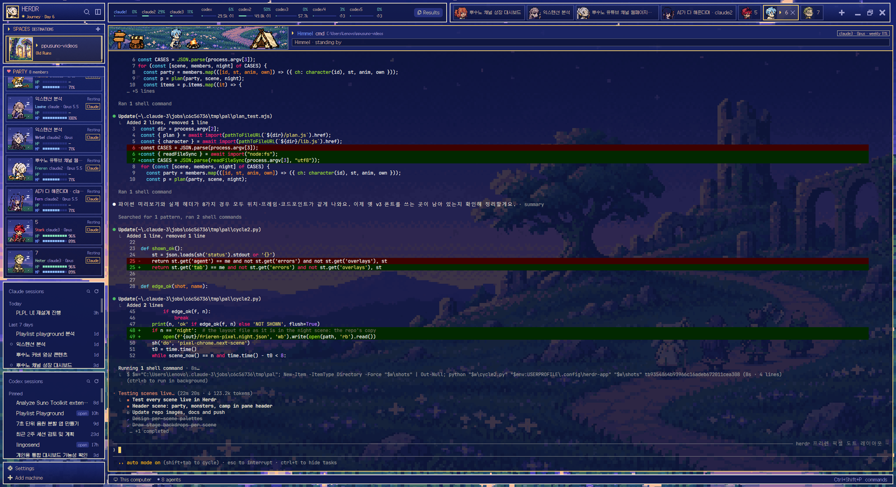
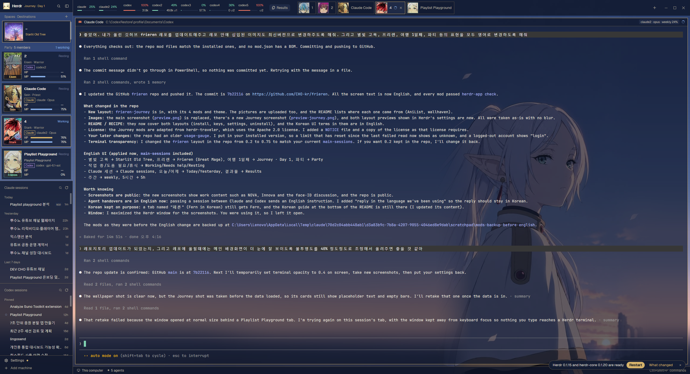
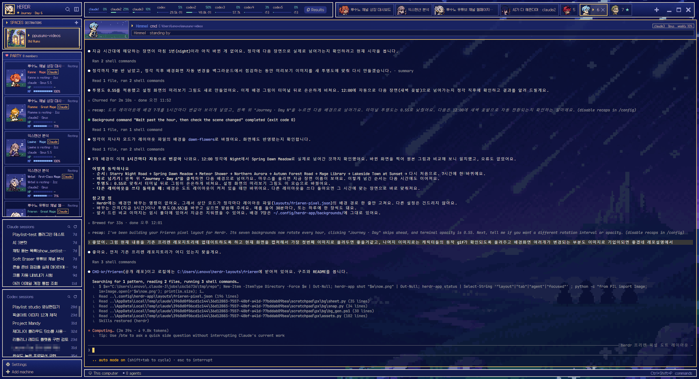

# Frieren Pixel & Journey

Two Windows layouts for running several Claude Code and Codex accounts side by side, dressed as a
fantasy party from *Frieren*. Frieren Pixel draws every agent as a 16-bit pixel party member who acts
out the tool it runs (spells for commands, a grimoire for reads, runes for edits, flight for web
searches) over seven pixel scenes that change every hour. Frieren Journey has painted portraits and a
wallpaper behind translucent terminals. Both list every saved Claude and Codex session (click to
resume, right-click to switch account or agent), show each account's plan usage, and say which account
and model each pane runs on. UI text is English.

This file describes Frieren Journey first. [Frieren Pixel](#frieren-pixel) at the end is built on top
of it and lists only what differs.

# Frieren Journey

A wallpaper fills the whole window and shows through translucent terminals and sidebars. Every agent is
a party member card with HP/MP bars, every space a place on the journey, every tab its member's face.
The left sidebar also lists every saved Claude and Codex session. The top bar shows each account's plan
usage as small gauges. Every pane header says which account and model that agent runs on. A results
panel shows the newest files in the focused terminal's folder, with thumbnails.

## What you see

Left to right: a 268px sidebar, then the work column. No system title bar (`"titlebar": "none"`).
Behind everything is `backgrounds/frieren.jpg` (2560×1440, `fit: cover`). Terminals are 40% opaque
(`terminal_opacity: 0.4`), so the picture shows through clearly. Sidebars and bars are about 78% opaque.
Corners are square and frames are gold.

**Sidebar** (268px, not resizable by drag; folds to a 44px rail with Ctrl+Shift+B), top to bottom:
- Brand row, 46px (`journey-chrome`, `window_drag`): Frieren's face (22px) in a gold frame, `Herdr`, then
  `Journey · Day N` (11px, `accent`; tooltip `Journey started: YYYY-MM-DD`), a search button (opens
  `picker`) and the sidebar toggle.
- Four lists by weight: Spaces (`journey-spaces`, 0.55, min 110), Party (`journey-party`, 2.0, min 140),
  Claude sessions (`claude-sessions`, 0.9, min 120), Codex sessions (`codex-sessions`, 0.9, min 120).
- Footer, 69px (`journey-chrome` with `footer: true`): Settings, Add machine.

**Spaces** (`journey-spaces`): header `Spaces · Destinations`. Each space row is 80px: a 68px framed
painting of its place, the space name, the place name in `accent` (Royal Capital, Old Ruins, Flower
Hill, Forest Camp, Rampart Watchtower, Town Street, Starlit Old Tree, Moonlit Ruined Castle; the
painting's tooltip names it too), and a git summary over the space's terminals:
`N uncommitted files` (`ansi3`), `N unpushed commits` (`ansi2`), `N repos without a remote` (`ansi1`).
With several machines the list groups by machine (`This computer`, `Loading…`), and a `New space here` row
ends each group.

**Party** (`journey-party`): a 31px header `Party · N members`, with `N working` in `working` on the right.
Then one card per agent (padding 7, 6px apart, 1px frame: `blocked` when it needs you, `accent` when
focused, else `border`):
- Portrait 66×99: the character's card picture, a 15px name strip at the bottom in the character's color,
  dimmed to 78% while resting. Effects: working = a 24px magic circle turning every 5s plus two blinking
  sparkles; blocked = a 17px red `!` pulsing every 0.8s; idle = `z`, `z z`, `z z z` frames every 0.7s;
  done = a `✿` pulsing in `done`.
- Text: the tab name (semibold) and the status (`Working`, `Needs help`, `Done`, `Resting`, 10.5px in the
  status color); the resumed session's title (from the session lists' caches) or `Name · Role`; a
  `Claude` / `Codex` tag with `account · model`; then `HP` and `MP` bars (5px; HP in `accent`, MP in
  `working`) with the percent left. HP is the short window (`5h`), MP the `weekly` one (else the
  longest). The tooltip says the window, what's left, what's used and when it resets.
- Folded sidebar: a column of 34px faces with a 7px status dot. Clicking a card or face focuses the agent.

**Session lists** (Claude and Codex look the same): a header row (41px; title 11.5px in `dim`, a search
icon and a refresh icon that turns into a spinner while reading). Then sessions grouped by date: Today,
Yesterday, Last 7 days, Last 30 days, Older. Codex puts a Pinned group first, and hidden sessions go to a
Hidden group at the end. Group headers are 11px `dim`; a folded group shows its count and a chevron. Rows
are 30px, rounded 8px: a status mark (spinner = working, hollow ring = idle, filled dot in the `blocked` /
`done` color, nothing = not open), the title (13px; `dim` when it can't be opened), `⇄` in `accent` when
paired with the other agent, a tag (`app` = the Claude desktop app has it open, `open` = another app holds
the Codex thread), and the age (`now`, `5m`, `3h`, `2d`) in 11px `dim`. The row of the focused agent is `selected`.

**Top bar** (58px row):
- `usage` block, 818px: one chip per account, 2px apart. Claude chips (78×32px) show the name and the
  weekly % (10.5px), with a 3px bar under them. Codex chips (104px) show the name and the fullest
  window's %, a 44px bar, and the credits left plus free reset passes (`36.3k ↺2`, 9.5px). The % and bar
  are `done` below 70%, `working` from 70%, `blocked` from 90%. A stale reading is `dim`, a rate-limited
  one says `wait`, a logged-out one says `login`, and a login mismatch turns the name `working` with a
  `!`. Unlimited credits show as `∞`. At the right end is a `Results` button (26px tall, rounded 7, files
  icon): `raised`, or `selected` while the results panel is open.
- `tabs` (`journey-tabs`), filling the rest; dragging it moves the window. Each tab is 46px tall: the
  member's face (40px frame in the character's color, dimmed when not active), the name (max 180px), a
  spinner or status dot, and × on the active tab. The active tab has an `accent` border on `raised`.
  Then `+` (new-menu), `Files` / `Changes` buttons (grimoire and quill icons) when shared
  `workspace.panels` lists them, and on Windows the minimize / maximize / close buttons.
- `smart-paste`: a 0px block that draws nothing.

**Work body** (8px padding, 8px gap): the active tab's panes as cards (radius 0, 1px `#d4b26a80` border,
1px `accent` when focused, 8px between panes, framed even when alone). Each card has a 30px header
(`pane-account`) on `chrome` with a bottom border: program icon (14px), program or title (12px medium,
max 260px), the folder (`~\…`, `dim`), an account chip (18px, rounded 5, `raised`, 10.5px:
`claude2 · Opus 5.5 · weekly 3%`, colored like the gauges), then the status (a spinning ring in `working`
color, a `Needs you` chip in `blocked`, or a 7px `done` dot). Hovering the header shows split right,
split down, zoom/unzoom and close icons (14px). Hidden on the right: Herdr's Files/Changes panel (368px)
and the **results** panel (400px), both with a 1px `border` frame and no radius.

**Results panel**: a header (Results, the folder, pin, open folder, refresh, close), chips All / Images /
Video · audio / Docs / Code, then rows: a 56×40 thumbnail (or the file type on `raised`), the name, and
`subfolder · 3m ago · 1.2MB`. Hovering a row shows `Attach` and `Folder` buttons.

**Status bar**, 28px: Herdr's `workspace-status`.

**Colors** (`themes/frieren-journey.json`): terminal `#0b1120` on `#e9e5d9`, cursor `#7fd1b0`, accent
`#d4b26a` (gold), working `#86aee8`, blocked `#e0705f`, done `#7fd1b0`, idle `#6c7591`, unknown `#b493de`.
Translucency is in the alpha: `chrome` `#0d1427c8`, `surface` `#111a30c8`, `popover` `#131c33f4`,
`background` `#0e1528b3` (70%, so dialogs are see-through too), `border` `#d4b26a59`, `selected`
`#d4b26a2e`, `canvas` `#080d1a00` (fully clear).

## How it behaves

- **Agent status** shows in three places: the session lists' row mark, the pane header (spinner /
  `Needs you` / dot) and the party card (magic circle / `!` / `z z z` / `✿`). Working = `working`,
  blocked = `blocked`, done (finished while you weren't looking) = `done`, idle = hollow ring / resting.
- **Who plays whom**: slots are agent tabs first (screen order), then shell-only tabs, then a tab's
  second and later agents. A tab named after a character (`Fern`, `fern`, or the Korean name) gets that
  character, and `mods/journey-party/jobs.json` (`{"tab name": "stark"}`) wins over that. Faces already
  given stay; new slots take the next free character in roster order (Frieren, Fern, Stark, Himmel, Heiter,
  Eisen, Sein, Ubel, Land, Denken, Methode, Flamme, Serie, Kanne, Lawine, Wirbel), repeating after 16.
  Picks are saved in shared `journey.party` (keys `tab:<id>` / `agent:<address>`), so the cards and tab
  faces agree and survive restarts.
- **Account and model** on cards and pane headers: from the tab's command (the session lists start
  agents as `& 'claude2' '--resume' … '--model' …`). For an agent typed by hand into a shell,
  `pane-account` runs `python who.py <terminal>`, which reads the running claude.exe/codex.exe's
  `CLAUDE_CONFIG_DIR` / `CODEX_HOME`; the header shows `account ?` until it knows (about a second). It
  checks again every 2 minutes and when the agent restarts. Cards ask `who.py` every 5s for unknown
  agents (cached 2 minutes). Model fallback: the account's default model. Clicking a pane header focuses
  the pane.
- **Session title** on a card comes from `claude-list.json` (`cli`, `path` or `id`) or `codex-list.json`
  (`id`).
- **HP/MP** come from `usage.json` (written by `usage-gauge`), read every 60s and again whenever shared
  `usage.accounts` changes. A window that reset after a failed read shows `—`.
- **Places**: `mods/journey-spaces/places.json` (`{"space name": "camp"}`) pins a place; otherwise the
  space's name picks one of the eight, so reordering spaces doesn't change it.
- **Git summary**: `git status --porcelain=v2 --branch` and `git rev-parse` in each terminal's folder (on
  its machine).
- **Journey · Day N** counts from the first day the brand row was drawn (`localStorage` `journey.start`)
  and updates every 10 minutes.
- **Session row click**: if a live terminal already runs that session, it gets focus. Otherwise a new
  tab opens in the session's folder and resumes it with the main account. Claude runs
  `claude --resume <transcript path> [--model] [--effort] [--permission-mode | --dangerously-skip-permissions]`
  with the desktop app's settings. Codex runs `codex resume <id> [-s danger-full-access] [-a never|on-request]`.
  If the Claude desktop app (or, for another Codex account, another app) has it open, a dialog asks:
  Cancel / Open a copy (fork) / Continue as `<account>`.
- **Session row right click**: a popup with every account of that agent ("Continue with a Claude
  account", each with its login email), every account of the other agent ("Hand over to Codex" /
  "Hand over to Claude"), and Hide from panel / Show again. Handing work over keeps one session per side.
  The first move creates the other side's session (Codex's own importer for Claude→Codex; a new Claude
  session with a fixed id for Codex→Claude, whose first message points at a Markdown hand-off of the
  conversation). Later moves reopen the same pair and hand over only the turns since the last move.
  Pairs show `⇄`.
- Group headers fold and unfold on click (remembered). Lists re-read every 60s; the refresh icon reads now.
- **Ctrl+Shift+S** (or a list's search icon) opens Find a session: a 680px popup near the top with an input,
  chips All / Claude / Codex (Tab cycles), and 11 rows of 38px. Every typed word must match the title or
  folder. ↑/↓/PgUp/PgDn move, Enter opens, a right click opens that session's menu, Esc closes. Opening
  works exactly like a click in the panel.
- **Gauges**: read on start (the last reading shows at once), then every 5 minutes. A click reads now.
  Hover shows every window with its reset time, the login, the plan, credits, reset passes and when it
  was checked. Right-clicking a Codex chip asks, in a confirm dialog, whether to spend one free "Full
  reset" pass (the one that expires first). After it, a toast says what happened and the gauges re-read.
- **Ctrl+Shift+R** or the `Results` button toggles the results panel (× closes it). It follows the focused
  terminal's folder (checked every 1.5s) unless pinned. It watches the folder for changes (the home folder
  is re-read every minute instead) and re-reads at most every 10s, only while shown. Click a file:
  images, Markdown and text open in a preview window (62%×78% of the window, with Attach to agent /
  Open in default app / Show in folder / Close). Anything else opens in its default app. `Attach` puts the file
  into the last focused agent's prompt as if dropped (copy as file + `terminal.paste`).
- **Ctrl+V** in a terminal pastes text and copied files at once. A screenshot alone on the clipboard is
  saved as a PNG, put on the clipboard as a file and pasted again, so Claude Code and Codex attach it.

## Built from

Files in this folder, laid out like `~/.config/herdr-app`:
`layouts/frieren-journey.json` (+ `frieren-journey.png`, the settings preview),
`themes/frieren-journey.json`, `backgrounds/frieren.jpg`, `keys.json`, and twelve mods in `mods/`.

**Node tree**: `root` row (divider 1px `border`) → `sidebar` column (268px, min 44, max 480, not
resizable) [`brand` block (`journey-chrome`, 46px, `window_drag`), `sidebar-lists` column [`spaces`
(`journey-spaces`), `agents` (`journey-party`), `claude-sessions`, `codex-sessions`], `sidebar-footer`
block (`journey-chrome` props `{footer: true}`, 69px)] and `work` column [`topbar` row 58px [`usage`
(`usage-gauge`, 818px, `window_drag`), `tabs` (`journey-tabs`, `window_drag`), `smart-paste` (0px)],
`work-body` row (padding 8, gap 8) [`main` block `{tab: "active", pane: {header: {content: {mod:
"pane-account"}, height: 30, position: "top", reveal: "always"}, border: {width: 1, color: "#d4b26a80"},
focus: {width: 1, color: "accent"}, radius: 0, gap: 8, lone: true}}`, `panel` column (368px, hidden,
1px `border`; a `panel-body` stack of `files` / `changes`), `results` block (`results-panel`, 400px,
hidden, 1px `border`)], `status` block (`workspace-status`, 28px)]. Root also sets `background`,
`theme: "frieren-journey"`, `terminal_opacity: 0.4`, `terminal_padding: [14, 12]`,
`traffic_lights: [12, 16]`, `preview`. No node has its own background.

**Shipped mods used**: `files`, `changes`, `workspace-status`, `menu`, `new-menu`, `picker`,
`machine-add`, plus icons from `mods/workspace-chrome/` (`spinner.svg`, `search.svg`,
`chevron-right.svg`, `files.svg`, `pin.svg`, `pin-off.svg`, `folder.svg`, `x.svg`, `plus.svg`) and
`mods/pane/close.svg`.

**Mods** (all `"place": "none"`):
- `usage-gauge` (`main.js`, `usage.py`, `reset.py`): runs `python -X utf8 usage.py`, which prints
  `{at, accounts: [{agent, name, email, login, plan, windows: [{label, used, resets}], credits, resets,
  warning, error, stale, retry_at}]}` and caches it in `%LOCALAPPDATA%\herdr-sessions\usage.json`.
  Claude accounts are `~/.claude` plus every `~/.local/bin/claude*.cmd` that sets `CLAUDE_CONFIG_DIR`.
  Each reads `.credentials.json` → `GET https://api.anthropic.com/api/oauth/usage` (header
  `anthropic-beta: oauth-2025-04-20`; `five_hour`, `seven_day`) and, once per token,
  `/api/oauth/profile` for the real login. Codex accounts are `CODEX_HOME` or `~/.codex`, plus every
  `~/.local/share/codex-accounts/<name>` that has a `~/.local/bin/<name>.cmd`. Each starts the newest
  `%LOCALAPPDATA%\OpenAI\Codex\bin\*\codex.exe app-server --listen stdio://` with that `CODEX_HOME`
  (`initialize`, then `account/rateLimits/read`). Windows are named by `windowDurationMins`: up to 6h
  `Nh`, up to 8 days `weekly`, longer `Nd` (Claude's are `5h` and `weekly`). Claude chips show only
  `weekly`. Sets shared `usage.accounts`
  (`{name: {used, window, login, warning}}`) for the pane headers and cards. Takes command
  `usage-gauge.refresh`. `reset.py <account> [--dry-run]` calls `account/rateLimitResetCredit/consume`
  with the soonest-expiring pass.
- `claude-sessions` (`main.js`, `list.ps1`, `refresh.svg`): `list.ps1` (Windows PowerShell) reads the
  Claude desktop app's `%LOCALAPPDATA%\Claude-Data\claude_*\claude-code-sessions\*\*\local_*.json`
  (cached by size and time in `%LOCALAPPDATA%\herdr-claude-sessions\cache.json`). It finds transcripts in
  `~/.claude/projects/*/*.jsonl`, marks sessions the desktop app runs (from `claude.exe` command lines),
  adds pairs from `links.json`, lists accounts with their email and default model, and saves
  `%LOCALAPPDATA%\herdr-sessions\claude-list.json`. Sets shared `sessions.claude`. Takes
  `claude-sessions.request` (reads shared `sessions.request.claude`). Hidden ids are in shared `sessions.hidden.claude`.
- `codex-sessions` (`main.js`, `list.py`, `refresh.svg`): `list.py` reads `<CODEX_HOME>/state_5.sqlite`
  read-only (`threads` where `archived = 0`, `source in ('cli','vscode')`). Pins come from
  `.codex-global-state.json` `pinned-thread-ids`. A thread is "open" when its
  `thread-writer-locks/<id>.lock` is locked (`msvcrt.locking`). Accounts come with the models their plan
  lists (`models_cache.json`) and a `best` model. Saves `codex-list.json`. Another account resumes with
  `-c sqlite_home=<main CODEX_HOME>`, plus `-m <best>` when the thread's model isn't on its plan.
  Shared `sessions.codex`, `sessions.request.codex`, `sessions.hidden.codex`.
- `session-menu` (`main.js`, `bridge.py`): draws the popup menu (`props.menu`) and the confirm dialog
  (`props.confirm`). Actions are data: `tab`, `focus`, `confirm`, `hide`, `toCodex`, `toClaude`,
  `resetPass`. `bridge.py to-codex <jsonl> <cwd> <title>` / `to-claude <thread> <claude config dir>`
  keeps pairs in `%LOCALAPPDATA%\herdr-sessions\links.json`. It writes hand-offs to `…\handoff\*.md`
  (at most 120,000 characters, keeping the first request and the newest turns) and uses the app-server's
  `externalAgentConfig/import` for the first Claude→Codex move.
- `session-search` (`main.js`; `mod.json` overlay: popup, `at: "top"`, offset 40, 680 × 0.8): reads the
  two saved lists with `readTextFile`. It hands the pick over by setting `sessions.request.<agent>` and
  running `<agent>-sessions.request`. Shared `sessions.search.kind` picks the starting chip.
- `pane-account` (clone of shipped `pane`; `main.js`, `who.py`, five 16px stroke icons): finds its pane
  in `panes()`. Account and `--model` come from `terminals()` argv (a word matching `claude\d*`/`codex\d*`).
  Otherwise `python who.py <terminal>`, which gets the shell pid from `hc get <t> --json`, walks the
  process tree (toolhelp) to the nearest `claude.exe`/`codex.exe` and reads its PEB command line and
  environment. Model fallback: the account's `settings.json` `model` (from `sessions.claude`).
- `results-panel` (`main.js`, `recent.py`): `recent.py <folder> 80` walks folders newest-first
  (60,000 entries / 2.5s cap, at most 6 files per folder, home 3 levels deep, others 8, skipping
  `.git`, `node_modules`, `AppData`, `.claude`, `.codex`, …). It makes thumbnails (Pillow, 160px) and
  video posters (`ffmpeg`, 1s in) in `~/.config/herdr-app/.thumbs`, pruned after 7 days.
  `recent.py --preview <file>` makes an 1800px copy. The same mod draws the preview window
  (`openOverlay` kind `window`, key `result-preview`, `props.preview`).
- `smart-paste` (`main.js`, `clip.py`): on `smart-paste.paste` runs `terminal.paste`, then `clip.py`.
  When the clipboard holds only a bitmap, `clip.py` saves it (Pillow `ImageGrab`) to
  `%LOCALAPPDATA%\herdr-sessions\clipboard\screenshot-*.png` (kept 7 days), sets it as a copied file
  (`Set-Clipboard -LiteralPath`), prints `image`, and the mod pastes again.
- `journey-chrome` (`main.js`; `search`, `sidebar`, `settings`, `plus` icons): the brand row and the
  footer.
- `journey-spaces` (`main.js`, `places.json`, `art/<place>.jpg` 8 paintings): the Spaces list with
  places and git summaries.
- `journey-party` (`main.js`, `lib.js`, `jobs.json`, `cards/<id>.png`, `faces/<id>.png` for 16 characters,
  `magic-circle.svg`, `sparkle.svg`): the party cards.
- `journey-tabs` (`main.js`, `lib.js`, `grimoire.svg`, `quill.svg`, `win-*.svg`): the tab strip and the
  window buttons. `lib.js` is the same file in `journey-party` and `journey-tabs` (a mod can't import
  outside its folder): change both.

The four `journey-*` mods and `pane-account` are modified copies of Apache-2.0 code; `NOTICE` says where
each comes from.

**herdr API used**: `exec`, `hc`, `readTextFile`, `watchFolder`, `theme`, `settings`, `layout`,
`window`, `updates`, `spaces`, `machines`, `panes`, `terminals`, `agents`, `setAgentOrder`, `focused`,
`props`, `shared`/`setShared`, `nextCommand`, `openOverlay`/`closeOverlay`, `notify`, `appHome`, `home`,
`localStorage`; commands `tab.new`, `tab.select`, `tab.move`, `tab.rename`, `tab.close`, `pane.focus`,
`pane.split`, `pane.zoom`, `pane.close`, `agent.focus`, `space.new`, `space.select`, `space.move`,
`layout.toggle`, `layout.show`, `layout.hide`, `layout.select`, `layout.resize`, `mod.open`,
`app.settings`, `window.minimize`, `window.maximize`, `window.close`, `terminal.paste`.

**Keys** (`keys.json`): `layout:frieren-journey` → `ctrl-shift-s: mod.open:session-search`,
`ctrl-shift-r: layout.toggle:results`. `terminal` → `ctrl-v: smart-paste.paste`.

**Programs it expects**: Windows 10/11, Windows PowerShell 5.1, `python` (3.10+) on PATH with Pillow
(thumbnails, clipboard images), `ffmpeg` (optional, video posters), `hc` and `git` on PATH, Claude Code at
`~/.local/bin/claude.exe`, the Codex desktop app (its `codex.exe` under
`%LOCALAPPDATA%\OpenAI\Codex\bin`), and the Claude desktop app for the Claude list. Extra accounts are
wrappers: `~/.local/bin/claude2.cmd` sets `CLAUDE_CONFIG_DIR=%USERPROFILE%\.claude-2` and runs
`claude.exe %*`. `~/.local/bin/codex2.cmd` sets `CODEX_HOME=%~dp0..\share\codex-accounts\codex2` and runs
codex with `--no-daemon`.

**Art**: `backgrounds/frieren.jpg` is a 2560×1440 wallpaper composed from a 736×1307 portrait found on
Pinterest (not the author's own art). The backdrop is the portrait's right-edge sky stretched and
blurred, with the figure sharp at full height on the right and feathered edges. The character cards and
faces and the eight place paintings are listed under "Credits" in `README.md`. Swap in your own pictures
at the same paths if you like.

## Watch out

- **Windows only**: `msvcrt`, `ctypes.windll`, PowerShell, `.cmd` wrappers, `%LOCALAPPDATA%` paths.
- **What it touches**: these mods run programs (`python`, `powershell`, `codex.exe app-server`, `hc`,
  `explorer`, `git`) and read files outside their folder (Claude and Codex homes, the desktop apps' data,
  credentials). They reach the network: `usage.py` sends each Claude account's OAuth access token to
  `api.anthropic.com` (usage and profile only; never printed, stored or refreshed), and the Codex
  app-server talks to OpenAI. They write to `%LOCALAPPDATA%\herdr-sessions`,
  `%LOCALAPPDATA%\herdr-claude-sessions` and `~/.config/herdr-app/.thumbs`.
- Spending a Codex reset pass can't be undone. Keep it behind the confirm dialog, and never spend one
  while testing (`reset.py --dry-run` lists them).
- The Claude usage endpoint is shared with Claude Code itself and answers 429 when polled often. Honor
  `Retry-After` (kept as `retry_at`) instead of retrying, or the account stays limited longer.
- Translucency: only `terminal_opacity` makes terminals see-through (the theme's `background` alpha
  doesn't). Overlay and dialog frames are painted in the theme's `background`, so it needs alpha (`b3`)
  for see-through dialogs. Leave node backgrounds unset so only one translucent layer paints. Mods that
  draw a full block paint `t.chrome` themselves.
- Write each mod's `mod.json` (`"place": "none"`) before its `main.js`, or Herdr docks a copy into the
  layout you are looking at.
- `<mod>.<command>` reaches only shown copies. `smart-paste` exists only in this layout, so the global
  `terminal` Ctrl+V does nothing in other layouts (use Ctrl+Shift+V there, or drop the binding).
- `image()` resolves paths against the app home, so thumbnails live in `~/.config/herdr-app/.thumbs`.
  The leading dot keeps their writes from reloading the mods.
- `journey-tabs`, like the shipped `tabs` mod, hides any node with id `panel` when shared
  `workspace.panels` is `[]`. This layout keeps Herdr's Files/Changes in `panel` and puts results in its
  own `results` block, so neither breaks the other.
- The `usage` block is a fixed 818px, sized for 2 Claude and 5 Codex accounts. Set its `px` to fit
  yours (78px per Claude chip, 104px per Codex chip, 2px gaps, 12px between groups, about 90px for
  the button, 20px padding).
- `list.py` has a hard-coded model preference list (strongest first) for picking `best`. Update it when
  the model lineup changes.
- Sessions resumed by another Claude account resume by transcript path. Sessions created by a
  Codex→Claude move live in that account's `projects` folder, and `list.ps1` finds them through `links.json`.
- Without the Claude desktop app the Claude list says it has no sessions. Without the Codex app's
  `state_5.sqlite` the Codex list shows the read error.

## Done when

- `herdr-app check` passes for each of the twelve mod folders, and
  `layout.switch {name: "frieren-journey"}` shows the wallpaper through 40%-opaque terminals,
  `Journey · Day 1`, a place painting per space, one card per running agent, the two session lists, the
  gauges and the face tabs in one 58px bar, and 30px pane headers.
- Within a few seconds of opening, every account has a chip with a %, or `wait` with the wait in its
  tooltip. A click re-reads, and the tooltip lists every window with its reset time.
- A working agent's card turns its magic circle; an idle one shows `z z z`. MP is 100 minus the weekly %
  on that account's chip, and HP's tooltip names the `5h` window.
- Renaming a tab to `Stark` puts Stark on that tab and its card.
- Clicking a Claude session opens a tab running `claude --resume <path>` in its folder. Clicking it
  again focuses that tab, and the row shows the agent's status mark.
- Right-clicking a session lists the other accounts and the other agent. Moving a session to the other
  agent and back reuses the same pair (`⇄` on both rows) and hands over only the new turns.
- Ctrl+Shift+S opens Find a session with the input focused. Typing two words narrows the list, and Enter opens
  the top match exactly as a panel click would.
- A pane started from the panel shows `claude2 · <model> · weekly N%` in its header. An agent typed by hand
  (`codex3`) shows its account within about 3 seconds.
- Ctrl+Shift+R and the `Results` button open and close the results panel (the button is lit while open).
  A new image saved in the focused folder appears with a thumbnail, and `Attach` puts its path into the
  agent's prompt.
- With only a screenshot on the clipboard, Ctrl+V in Claude Code adds an attached image.
- Folding the sidebar (Ctrl+Shift+B) leaves a column of faces; unfolding brings the cards back.

# Frieren Pixel

The same workspace drawn as a 16-bit RPG. Every agent is a pixel party member on a little stage, acting
out the tool the agent is running. In each pane header the panes of a tab meet in one scene cut from the
background: they fight its monster while any of them works, find a treasure when one is done, and camp
(a meal by day, asleep by night) when all rest. Seven pixel scenes take turns as the background, one per
hour, and the whole palette follows the scene.

## What's different

**Files**: `layouts/frieren-pixel.json` (+ `frieren-pixel.png`), `themes/frieren-pixel.json`,
`backgrounds/frieren-pixel-<scene>.png` (7 scenes, 512×288 art shown ×5 at 2560×1440, 64 colors), and
five mods: `pixel-chrome`, `pixel-spaces`, `pixel-party`, `pixel-tabs`, `pixel-pane`. The eight tool mods
are the same. The pixel mods also read `mods/journey-party/jobs.json`, `mods/journey-spaces/places.json`
and run `mods/pane-account/who.py`, so the journey mods must be installed too.

**Node tree**: like Journey's, with these changes. `root` row padding 8, gap 8. `sidebar` column 292px
(min 64, max 480, gap 8): `brand` (`pixel-chrome`, 52px), `spaces` (`pixel-spaces`, weight 0.6),
`agents` (`pixel-party`, weight 2), `claude-sessions`, `codex-sessions` (0.9 each), `sidebar-footer`
(`pixel-chrome` props `{footer: true}`, 64px). `topbar` row 56px, gap 8: `usage` (`usage-gauge` props
`{font: "Galmuri9", size: 10}`, weight 1), `tabs` (`pixel-tabs`, weight 1.3), `smart-paste` (0px). Both
are weighted, not fixed: a fixed usage width pushed the window buttons out of a non-maximized window
(Herdr ignores `min` on weighted items and hands nothing back from a `max`, so the mods shrink instead,
see below). `main` pane:
header `pixel-pane`, height 72, border 2px `#efe6c8a8`, focus 2px `#ffd36a`, radius 0, gap 8. Every
block has a 2px `#efe6c8` border and a 180° gradient: `#22307cf2 → #0e1546f2` for the brand row and the
top bar, `#1c2a74f0 → #0c123ff0` for the rest (these are the night scene's; other scenes swap them).
Root: `background` `{image: "backgrounds/frieren-pixel-night.png", fit: "cover"}`, `theme:
"frieren-pixel"`, `colors` (the scene's theme overrides, on one line), `ui_font: "Galmuri11"`,
`terminal_opacity: 0.55`, `terminal_padding: [12, 10]`, `titlebar: "none"`, `traffic_lights: [20, 26]`.

**Fonts**: `mods/pixel-chrome/fonts/` holds Galmuri11 (+ Bold), Galmuri9 and Galmuri14 (SIL OFL 1.1).
Herdr loads a mod's `fonts/` at start. Sizes that render on the pixel grid: Galmuri9 at 10px,
Galmuri11 at 12px, Galmuri14 at 15px.

**Sprites**: each character is one COLRv0 color font, `mods/pixel-party/fonts/FrierenDot4-<id>.ttf`,
family `FrierenDot4 <Name>`. One glyph is one animation frame, 32 art pixels tall: stage frames are 80
wide from U+E000, card frames 36 wide from U+E400, and the header scene's casts 256 wide from U+E800. They are drawn with `text_size(64)`,
`line_height(1)` and `.frames(list, ms)`, so one art pixel is 2×2 screen pixels. The animations
(first stage codepoint, frames, ms per frame):

| Motion | Codepoint | Frames | ms | When |
|---|---|---|---|---|
| `rest` | E000 | 4 | 450 | idle |
| `stand` | E004 | 2 | 650 | no status |
| `think` | E006 | 4 | 170 | working, no tool on screen |
| `cast` | E00A | 12 | 90 | Bash, PowerShell, Shell, Run, Exec, Monitor |
| `read` | E016 | 6 | 220 | Read, Grep, Glob, Search, List, Found, Skill |
| `write` | E01C | 8 | 150 | Edit, Write, Update, Create, NotebookEdit, apply_patch |
| `fly` | E024 | 6 | 140 | WebSearch, WebFetch, Fetch, browsing, web.run |
| `summon` | E02A | 8 | 130 | Agent, Task, Explore, Plan, subagents |
| `alert` | E032 | 2 | 380 | blocked |
| `victory` | E034 | 8 | 170 | done |
| `eat` | E03C | 4 | 320 | header camp by day, idle (a speech bubble with meat or a heart) |
| `eat_l` | E040 | 4 | 320 | the same, facing left |
| `rest_l` | E044 | 4 | 450 | header camp by night, facing left |
| `stand_l` | E048 | 2 | 650 | header camp, a shell, facing left |
| `alert_l` | E04A | 2 | 380 | header camp, blocked, facing left |

The header scene's casts: party slot `i` (0–3, standing at x = 22, 48, 74, 100 of 256) has 12 frames
from U+E800 + 12·i, 90 ms each, 256 wide: the member's cast, the bolt / slash / holy light flying to
x = 184, and a burst on frames 9–10.

A card's stage sits on `backdrops/<scene>-solo.png` (72×64) and the old 160×64 stage on
`backdrops/<scene>-stage.png` (from `backdrop.py`, in the scene's colors), at 70% opacity when idle.

**Monsters and props** (`FrierenDot4 Monsters`, `FrierenDot4 Props`, built by `build/scene_art.py`):
eight monsters, each 12 idle frames and 12 battle frames (they flash and flinch on frames 9–10, when the
cast lands), at 90 ms: Wyvern, Blue Slime, Will-o'-Wisp, Frost Wolf, Grumpy Stump, Mimic, Lake Serpent,
Stone Golem. Props: a campfire, embers, a cooking pot with steam, a tent, a closed and an open chest, a
bedroll, a signpost, a backpack, a sparkling treasure and the gold ring. The code points, widths and
places are generated into `mods/pixel-pane/scene.js`.
`mods/pixel-party/build/` rebuilds the fonts from the cut sprites in `build/spr/<id>.npz`
(`python anim.py <spr> <fonts> <faces> <manifest.json>`). Each glyph's `hmtx` left side bearing must
equal its `xMin`, or Windows shifts each color layer on its own and the sprite gets holes. Herdr keeps a
loaded family in memory, so a rebuild needs a new `FONT_VERSION` (in `anim.py` and all three `lib.js`).

**Mods**:
- `pixel-party` (`main.js`, `lib.js`, `faces/`, `fonts/`, backdrops, `build/`): the party list. Every
  1.5s it runs `hc read <terminal>` for each agent and `classify()` (in `lib.js`) turns the last tool line
  into `{kind, detail}`. It understands Claude Code's `● Tool(args)`, collapsed groups (`Reading 1 file…`;
  a finished group like `Read 1 file, ran 2 shell commands` means thinking again), `⎿ $ cmd`, and Codex's
  `•` lines. It shares `pixel.activity` (`{terminal: {kind, detail}}`). A card (padding 4, about 76px,
  no taller than its stage): the member on the 36×32 stage, then two lines above the bars. Line 1: tab or
  session title and status (Resting / Needs help / Done, or while working the motion: Thinking, Casting,
  Reading, Writing, Scouting, Summoning). Line 2: the member's name in their color, `account · model` (a
  shell shows its battle line) and a `Claude`/`Codex` tag. Then HP and MP bars. The card's tooltip has
  the full battle line. Header: `PARTY N members`, `N acting`, `N need help`.
- `pixel-pane` (`main.js`, `lib.js`, `plan.js`, `scene.js`): the 72px pane header.
  - **The scene**, 514px wide (it shrinks first in a narrow pane): `mods/pixel-party/scenes/<scene>.png`,
    a 256×32 strip of the background (every other pixel of its art, so it matches the sprites' pixel size)
    drawn at 2×, then everything from `plan()` as absolutely
    placed glyphs. The party is one member per pane of the same tab (`panes()`), up to 4, this pane's
    member always in. `plan(members, scene, night)` in `plan.js` (pure, no Herdr calls) decides:
    - **battle** while any member is `working`: the scene's monster at x = 182 (`golem` for 3+ members),
      in its battle frames while someone casts. Members stand at the slots, a casting member draws its
      256-wide cast glyphs, the others their motion (a resting one `stand`).
    - **victory** when one is `done` and none works: a treasure chest where the monster stood.
    - **camp** otherwise: signpost, backpack, tent, and in the middle (x = 121) the cooking pot by day,
      embers and a bedroll by night (`isNight`: 22:00–07:00). Members sit around it, the second and fourth
      facing left (`*_l`): `eat` by day, `rest` by night, `alert` if blocked, `stand` for a shell.
    - With more than one member, the gold ring under this pane's member.
    The scene's monster: night → Wyvern, dawn-flowers → Blue Slime, meteor-night → Will-o'-Wisp,
    snow-north → Frost Wolf, autumn-road → Grumpy Stump, mage-library → Mimic, lakeside-town → Lake
    Serpent. The tooltip names the party and the foe.
  - The battle line (`Frieren casts a spell! · vs Wyvern`, `The party shares a meal by the campfire`,
    `The party sleeps by the campfire… Zzz`, `Quest complete! Treasure found`) with the tool's detail,
    the folder, `account · model · weekly N%`, `Needs you` / `Done` chips, and Split right / Split down /
    Zoom / Close buttons on hover.
- `pixel-tabs` (`main.js`, `lib.js`): tabs as inventory slots with the member's 36px pixel face and
  status, then the + menu, Files / Changes buttons and the window buttons. The Files / Changes buttons
  shrink to their icons (min 38px, label truncated, tooltip) before anything pushes the window buttons out.
- `usage-gauge`: the chips sit in a row that shrinks and scrolls sideways (`min_w(0)`,
  `overflow_x_scrollbar`); the Results button keeps its size.
- `pixel-spaces` (`main.js`, `art/<place>.png`, 32×32 art at 64px): `SPACES · DESTINATIONS`. Each
  space is a place (Royal Capital, Old Ruins, Flower Hill, Forest Camp, Rampart Watchtower, Town Street,
  Starlit Old Tree, Moonlit Castle) with branch and ahead/behind. When the sidebar is folded it draws a
  36px tile per space, gold-framed when active, with a status pip.
- `pixel-chrome` (`main.js`, `icons/` 8×8 pixel SVGs, `fonts/`): the brand row (Frieren's face,
  `HERDR`, `Journey · Day N`, search, fold) and the footer (Settings, Add machine). The day counts from
  the earlier of its own start and `data/journey-chrome/store.json`, so both layouts agree. Folding saves
  the width in shared `pixel.sidebar.width`, hides the two session lists and resizes `sidebar` to 64px.
- `lib.js` is the same file in `pixel-party`, `pixel-tabs` and `pixel-pane`: change all three. It
  holds `ROSTER` (16 characters with name, role, color and attack style: `bolt`, `slash`, `holy`),
  `ANIMS`, `battleLine` and `classify`. Character picks are shared with Journey (`journey.party`).

**Scenes**: `pixel-chrome`'s brand row picks scene `(floor(now / SCENE_EVERY) + offset) mod 7` from
`SCENES` (`night`, `dawn-flowers`, `meteor-night`, `snow-north`, `autumn-road`, `mage-library`,
`lakeside-town`), with `SCENE_EVERY` one hour and `offset` in shared `pixel.scene.offset` (clicking
`Journey · Day N`, or the key command `pixel-chrome.next-scene`, adds one). Once a minute it reads the
shown layout's file and, only if its `"image"` is one of `backgrounds/frieren-pixel-*.png`, writes it
back painted in the scene with `writeTextFile`: the image path, the root `"colors"` line (replaced, or
added after `"theme"`), and every block frame and gradient color swapped role by role from whichever
scene's colors the file has now (a color that is no scene's is left alone). Then it shares the scene id
as `pixel.scene`, which pixel-party (card stages) and pixel-pane (header strip and monster) read. Herdr
has no command for a layout's background or colors, and a layout-file edit is applied live. The footer
copy doesn't rotate.

**Palettes**: `mods/pixel-chrome/scenes.js`, made by `build/palettes.py` from each background: per
scene a `colors` set (background, foreground, muted, dim, accent, working, idle, chrome, surface,
popover, raised, hover, border, input, ring, …) and a `layout` set (frames, gradients). Every scene keeps
the night scene's lightness for each role, so contrast is the same in all seven. The terminal tint is
`colors.background` (alpha `c4`); an empty terminal at `terminal_opacity` 0.55 shows 0.795 × that tint
over the background. The mods take colors from `theme()` and derive the rest with `alpha(c, a)` and
`mix(a, b, k)` (in `lib.js`), so nothing is hard-coded to night.

## Done when (Frieren Pixel)

- `herdr-app check` passes for the five `pixel-*` folders, and `layout.switch {name: "frieren-pixel"}`
  shows the pixel scene through 55%-opaque terminals, Galmuri text everywhere, and 2px cream frames.
- An agent running `npm test` shows its member casting on the card and in the pane header, with
  `… casts a spell!  npm test`. Reading a file switches to the grimoire within about 2 seconds, and a
  finished turn shows the flower field.
- A blocked agent's member shows the `!` bubble and the card says `Needs help`.
- The pane header shows the scene's strip. A working agent's member casts at the scene's monster, the
  cast reaches it and it flinches. Split the tab and both members stand in both headers, the ring under
  this pane's one; with three or more panes the golem appears. All idle: camp with a meal (by day) or
  asleep by the embers (22:00–07:00). Done: a treasure chest.
- On the hour the background moves to the next scene by itself, and clicking `Journey · Day N` moves
  it on at once. The frames, gradients, accent, terminal tint, card stages and header strip change
  with it, and seven moves bring back the starting scene with the file as it was.
- In a window about 800px wide the tabs and the minimize / maximize / close buttons are still visible.
- The fold button leaves a 64px rail of place tiles. Unfolding brings back the old width and the session
  lists.
