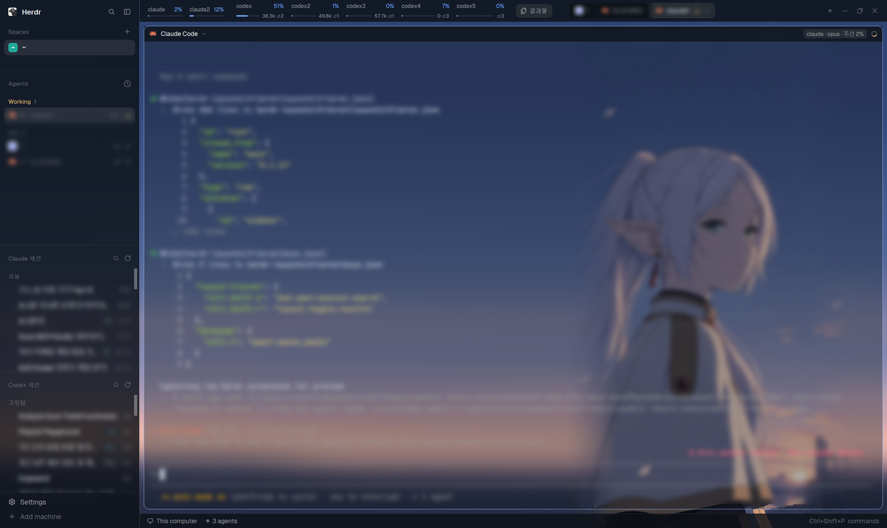

# Frieren

A Windows workspace for running several Claude Code and Codex accounts side by side. A wallpaper fills
the whole window and shows through translucent terminals and sidebars. The left sidebar lists your
spaces, live agents and every saved Claude and Codex session (click one to resume it, right-click to
open it with another account or hand it to the other agent). The top bar shows each account's plan
usage as small gauges. Every pane header says which account and model that agent runs on. A results
panel shows the newest files in the focused terminal's folder, with thumbnails. UI text is Korean.

## What you see

Left to right: a 268px sidebar, then the work column. No system title bar (`"titlebar": "none"`).
Behind everything is `backgrounds/frieren.jpg` (2560×1440, `fit: cover`). Terminals are 20% opaque
(`terminal_opacity: 0.2`), so the picture shows through clearly. Sidebars and bars are about 82% opaque.

**Sidebar** (268px, not resizable by drag; folds to a 44px rail with Ctrl+Shift+B), top to bottom:
- Brand row, 46px: Herdr's own `workspace-chrome` (logo, search, sidebar toggle). Dragging it moves the window.
- Four lists sharing the height by weight: Spaces (1), Agents (1), **Claude 세션** (1.6), **Codex 세션** (1.6), each at least 90/90/120/120px.
- Footer, 69px: `workspace-chrome` with `footer: true` (Settings, Add machine).

**Session lists** (Claude and Codex look the same): a header row (41px; title 11.5px in `dim`, a search
icon and a refresh icon that turns into a spinner while reading). Then sessions grouped by date: 오늘,
어제, 지난 7일, 지난 30일, 그 이전. Codex puts a 고정됨 (pinned) group first, and hidden sessions go to a
숨김 group at the end. Group headers are 11px `dim`; a folded group shows its count and a chevron. Rows
are 30px, rounded 8px: a status mark (spinner = working, hollow ring = idle, filled dot in the `blocked` /
`done` color, nothing = not open), the title (13px; `dim` when it can't be opened), `⇄` in `accent` when
paired with the other agent, a tag (`앱` = the Claude desktop app has it open, `열림` = another app holds
the Codex thread), and the age (`5분`, `3시간`, `2일`) in 11px `dim`. The row of the focused agent is `selected`.

**Top bar** (42px row):
- `usage` block, 818px: one chip per account, 2px apart. Claude chips (78×32px) show the name and the
  weekly % (10.5px), with a 3px bar under them. Codex chips (104px) show the name and the fullest
  window's %, a 44px bar, and the credits left plus free reset passes (`36.3k ↺2`, 9.5px). The % and bar
  are `done` below 70%, `working` from 70%, `blocked` from 90%. A stale reading is `dim`, a rate-limited
  one says `대기`, and a login mismatch turns the name `working` with a `!`. At the right end is a
  `결과물` button (26px tall, rounded 7, files icon): `raised`, or `selected` while the results panel is open.
- `tabs`: Herdr's shipped tab pills, filling the rest. Dragging it moves the window.
- `smart-paste`: a 0px block that draws nothing.

**Work body** (8px padding, 8px gap): the active tab's panes as cards (radius 10, 1px `border`, 1px
`accent` when focused, 8px between panes, framed even when alone). Each card has a 30px header
(`pane-account`) on `chrome` with a bottom border: program icon (14px), program or title (12px medium,
max 260px), the folder (`~\…`, `dim`), an account chip (18px, rounded 5, `raised`, 10.5px:
`claude2 · Opus 5.5 · 주간 3%`, colored like the gauges), then the status (a spinning ring in `working`
color, a `Needs you` chip in `blocked`, or a 7px `done` dot). Hovering the header shows split right,
split down, zoom/unzoom and close icons (14px). Hidden on the right: Herdr's Files/Changes panel (368px)
and the **results** panel (400px, radius 10, 1px border).

**Results panel**: a header (결과물, the folder, pin, open folder, refresh, close), chips 전체 / 이미지 /
영상·소리 / 문서 / 코드, then rows: a 56×40 thumbnail (or the file type on `raised`), the name, and
`subfolder · 3분 전 · 1.2MB`. Hovering a row shows `첨부` and `폴더` buttons.

**Status bar**, 28px: Herdr's `workspace-status`.

**Colors** (`themes/frieren-ink.json` dark, `themes/frieren-paper.json` light; the layout picks by
appearance). Ink: terminal `#111720` on `#cdd6e4`, accent `#91b6ee`, working `#e5c07b`, blocked
`#f0705f`, done `#76a8ff`. Translucency is in the alpha: `chrome` `#0c1016d0`, `surface` `#111720d0`,
`canvas` `#0e131b00` (fully clear), `popover` and `background` `…b3` (70%, so menus and dialogs are
see-through too). Paper is the same idea on white (`chrome` `#f1f1eed0`, accent `#1f62d0`).

## How it behaves

- **Agent status** shows in three places: the session lists' row mark, the pane header (spinner /
  `Needs you` / dot) and Herdr's own Agents list. Working = spinner in `working`, blocked = `blocked`,
  done (finished while you weren't looking) = `done` dot, idle = hollow ring.
- **Session row click**: if a live terminal already runs that session, it gets focus. Otherwise a new
  tab opens in the session's folder and resumes it with the main account. Claude runs
  `claude --resume <transcript path> [--model] [--effort] [--permission-mode | --dangerously-skip-permissions]`
  with the desktop app's settings. Codex runs `codex resume <id> [-s danger-full-access] [-a never|on-request]`.
  If the Claude desktop app (or, for another Codex account, another app) has it open, a dialog asks:
  취소 / 복사본으로 열기 (fork) / `<account>`로 이어가기.
- **Session row right click**: a popup with every account of that agent ("…계정으로 이어가기", each with
  its login email), every account of the other agent ("Codex로 넘기기" / "Claude로 넘기기"), and
  패널에서 숨기기 / 다시 보이기. Handing work over keeps one session per side. The first move creates the
  other side's session (Codex's own importer for Claude→Codex; a new Claude session with a fixed id for
  Codex→Claude, whose first message points at a Markdown hand-off of the conversation). Later moves reopen
  the same pair and hand over only the turns since the last move. Pairs show `⇄`.
- Group headers fold and unfold on click (remembered). Lists re-read every 60s; the refresh icon reads now.
- **Ctrl+Shift+S** (or a list's search icon) opens 세션 찾기: a 680px popup near the top with an input,
  chips 전체 / Claude / Codex (Tab cycles), and 11 rows of 38px. Every typed word must match the title or
  folder. ↑/↓/PgUp/PgDn move, Enter opens, a right click opens that session's menu, Esc closes. Opening
  works exactly like a click in the panel.
- **Gauges**: read on start (the last reading shows at once), then every 5 minutes. A click reads now.
  Hover shows every window with its reset time, the login, the plan, credits, reset passes and when it
  was checked. Right-clicking a Codex chip asks, in a confirm dialog, whether to spend one free "Full
  reset" pass (the one that expires first). After it, a toast says what happened and the gauges re-read.
- **Pane header**: the account comes from the tab's command (the session lists start agents as
  `& 'claude2' '--resume' …`). For an agent typed by hand into a shell, it reads the running
  claude.exe/codex.exe's `CLAUDE_CONFIG_DIR` / `CODEX_HOME` and shows `계정 ?` until it knows (about a
  second). It checks again every 2 minutes and when the agent restarts. Clicking the header focuses the pane.
- **Ctrl+Shift+R** or the `결과물` button toggles the results panel (× closes it). It follows the focused
  terminal's folder (checked every 1.5s) unless pinned. It watches the folder for changes (the home folder
  is re-read every minute instead) and re-reads at most every 10s, only while shown. Click a file:
  images, Markdown and text open in a preview window (62%×78% of the window, with 에이전트에 첨부 /
  기본 앱으로 열기 / 폴더에서 보기 / 닫기). Anything else opens in its default app. `첨부` puts the file
  into the last focused agent's prompt as if dropped (copy as file + `terminal.paste`).
- **Ctrl+V** in a terminal pastes text and copied files at once. A screenshot alone on the clipboard is
  saved as a PNG, put on the clipboard as a file and pasted again, so Claude Code and Codex attach it.

## Built from

Files in this folder, laid out like `~/.config/herdr-app`:
`layouts/frieren.json` (+ `frieren.png`, the settings preview), `themes/frieren-ink.json`,
`themes/frieren-paper.json`, `backgrounds/frieren.jpg`, `keys.json`, and eight mods in `mods/`.

**Node tree**: `root` row (divider 1px `border`) → `sidebar` column [`brand` block (`workspace-chrome`,
46px, `window_drag`), `sidebar-lists` column [`spaces`, `agents`, `claude-sessions`, `codex-sessions`],
`sidebar-footer` block (`workspace-chrome` props `{footer: true}`, 69px)] and `work` column [`topbar`
row 42px [`usage` (`usage-gauge`, 818px, `window_drag`), `tabs` (`tabs`, `window_drag`), `smart-paste`
(0px)], `work-body` row (padding 8, gap 8) [`main` block `{tab: "active", pane: {header: {content:
{mod: "pane-account"}, height: 30, position: "top", reveal: "always"}, border, focus, radius: 10, gap:
8, lone: true}}`, `panel` column (hidden; a `panel-body` stack of `files` / `changes`), `results` block
(`results-panel`, 400px, hidden)], `status` block (`workspace-status`, 28px)]. Root also sets
`background`, `theme: {light: "frieren-paper", dark: "frieren-ink"}`, `terminal_opacity: 0.2`,
`terminal_padding: [14, 12]`, `traffic_lights: [12, 16]`, `preview`. No node has its own background.

**Shipped mods used**: `workspace-chrome`, `spaces`, `agents`, `tabs`, `files`, `changes`,
`workspace-status`, plus icons from `mods/workspace-chrome/` (`spinner.svg`, `search.svg`,
`chevron-right.svg`, `files.svg`, `pin.svg`, `pin-off.svg`, `folder.svg`, `x.svg`).

**Mods** (all `"place": "none"`):
- `usage-gauge` (`main.js`, `usage.py`, `reset.py`): runs `python -X utf8 usage.py`, which prints
  `{at, accounts: [{agent, name, email, login, plan, windows: [{label, used, resets}], credits, resets,
  warning, error, stale, retry_at}]}` and caches it in `%LOCALAPPDATA%\herdr-sessions\usage.json`.
  Claude accounts are `~/.claude` plus every `~/.local/bin/claude*.cmd` that sets `CLAUDE_CONFIG_DIR`.
  Each reads `.credentials.json` → `GET https://api.anthropic.com/api/oauth/usage` (header
  `anthropic-beta: oauth-2025-04-20`; `five_hour`, `seven_day`) and, once per token,
  `/api/oauth/profile` for the real login. Codex accounts are `CODEX_HOME` or `~/.codex`, plus every
  `~/.local/share/codex-accounts/<name>` that has a `~/.local/bin/<name>.cmd`. Each starts the newest
  `%LOCALAPPDATA%\OpenAI\Codex\bin\*\codex.exe app-server --listen stdio://` with that `CODEX_HOME`
  (`initialize`, then `account/rateLimits/read`). Windows are named by `windowDurationMins`: up to 6h
  `N시간`, up to 8 days `주간`, longer `N일`. Claude chips show only `주간`. Sets shared `usage.accounts`
  (`{name: {used, window, login, warning}}`) for the pane headers. Takes command `usage-gauge.refresh`.
  `reset.py <account> [--dry-run]` calls `account/rateLimitResetCredit/consume` with the soonest-expiring pass.
- `claude-sessions` (`main.js`, `list.ps1`, `refresh.svg`): `list.ps1` (Windows PowerShell) reads the
  Claude desktop app's `%LOCALAPPDATA%\Claude-Data\claude_*\claude-code-sessions\*\*\local_*.json`
  (cached by size and time in `%LOCALAPPDATA%\herdr-claude-sessions\cache.json`). It finds transcripts in
  `~/.claude/projects/*/*.jsonl`, marks sessions the desktop app runs (from `claude.exe` command lines),
  adds pairs from `links.json`, lists accounts with their email and default model, and saves
  `%LOCALAPPDATA%\herdr-sessions\claude-list.json`. Sets shared `sessions.claude`. Takes
  `claude-sessions.request` (reads shared `sessions.request.claude`). Hidden ids are in shared `sessions.hidden.claude`.
- `codex-sessions` (`main.js`, `list.py`, `refresh.svg`): `list.py` reads `<CODEX_HOME>/state_5.sqlite`
  read-only (`threads` where `archived = 0`, `source in ('cli','vscode')`). Pins come from
  `.codex-global-state.json` `pinned-thread-ids`. A thread is "open" when its
  `thread-writer-locks/<id>.lock` is locked (`msvcrt.locking`). Accounts come with the models their plan
  lists (`models_cache.json`) and a `best` model. Saves `codex-list.json`. Another account resumes with
  `-c sqlite_home=<main CODEX_HOME>`, plus `-m <best>` when the thread's model isn't on its plan.
  Shared `sessions.codex`, `sessions.request.codex`, `sessions.hidden.codex`.
- `session-menu` (`main.js`, `bridge.py`): draws the popup menu (`props.menu`) and the confirm dialog
  (`props.confirm`). Actions are data: `tab`, `focus`, `confirm`, `hide`, `toCodex`, `toClaude`,
  `resetPass`. `bridge.py to-codex <jsonl> <cwd> <title>` / `to-claude <thread> <claude config dir>`
  keeps pairs in `%LOCALAPPDATA%\herdr-sessions\links.json`. It writes hand-offs to `…\handoff\*.md`
  (at most 120,000 characters, keeping the first request and the newest turns) and uses the app-server's
  `externalAgentConfig/import` for the first Claude→Codex move.
- `session-search` (`main.js`; `mod.json` overlay: popup, `at: "top"`, offset 40, 680 × 0.8): reads the
  two saved lists with `readTextFile`. It hands the pick over by setting `sessions.request.<agent>` and
  running `<agent>-sessions.request`. Shared `sessions.search.kind` picks the starting chip.
- `pane-account` (clone of shipped `pane`; `main.js`, `who.py`, five 16px stroke icons): finds its pane
  in `panes()`. Account and `--model` come from `terminals()` argv (a word matching `claude\d*`/`codex\d*`).
  Otherwise `python who.py <terminal>`, which gets the shell pid from `hc get <t> --json`, walks the
  process tree (toolhelp) to the nearest `claude.exe`/`codex.exe` and reads its PEB command line and
  environment. Model fallback: the account's `settings.json` `model` (from `sessions.claude`).
- `results-panel` (`main.js`, `recent.py`): `recent.py <folder> 80` walks folders newest-first
  (60,000 entries / 2.5s cap, at most 6 files per folder, home 3 levels deep, others 8, skipping
  `.git`, `node_modules`, `AppData`, `.claude`, `.codex`, …). It makes thumbnails (Pillow, 160px) and
  video posters (`ffmpeg`, 1s in) in `~/.config/herdr-app/.thumbs`, pruned after 7 days.
  `recent.py --preview <file>` makes an 1800px copy. The same mod draws the preview window
  (`openOverlay` kind `window`, key `result-preview`, `props.preview`).
- `smart-paste` (`main.js`, `clip.py`): on `smart-paste.paste` runs `terminal.paste`, then `clip.py`.
  When the clipboard holds only a bitmap, `clip.py` saves it (Pillow `ImageGrab`) to
  `%LOCALAPPDATA%\herdr-sessions\clipboard\screenshot-*.png` (kept 7 days), sets it as a copied file
  (`Set-Clipboard -LiteralPath`), prints `image`, and the mod pastes again.

**herdr API used**: `exec`, `readTextFile`, `watchFolder`, `theme`, `settings`, `layout`, `panes`,
`terminals`, `agents`, `focused`, `props`, `shared`/`setShared`, `nextCommand`, `openOverlay`/`closeOverlay`,
`notify`, `appHome`, `home`, `localStorage`; commands `tab.new`, `pane.focus`, `pane.split`, `pane.zoom`,
`pane.close`, `layout.toggle`, `layout.hide`, `mod.open`, `terminal.paste`.

**Keys** (`keys.json`): `layout:frieren` → `ctrl-shift-s: mod.open:session-search`,
`ctrl-shift-r: layout.toggle:results`. `terminal` → `ctrl-v: smart-paste.paste`.

**Programs it expects**: Windows 10/11, Windows PowerShell 5.1, `python` (3.10+) on PATH with Pillow
(thumbnails, clipboard images), `ffmpeg` (optional, video posters), `hc` on PATH, Claude Code at
`~/.local/bin/claude.exe`, the Codex desktop app (its `codex.exe` under
`%LOCALAPPDATA%\OpenAI\Codex\bin`), and the Claude desktop app for the Claude list. Extra accounts are
wrappers: `~/.local/bin/claude2.cmd` sets `CLAUDE_CONFIG_DIR=%USERPROFILE%\.claude-2` and runs
`claude.exe %*`. `~/.local/bin/codex2.cmd` sets `CODEX_HOME=%~dp0..\share\codex-accounts\codex2` and runs
codex with `--no-daemon`.

**Art**: `backgrounds/frieren.jpg` is a 2560×1440 wallpaper composed from a 736×1307 portrait found on
Pinterest (not the author's own art). The backdrop is the portrait's right-edge sky stretched and
blurred, with the figure sharp at full height on the right and feathered edges. Swap in your own picture
at the same path if you like.

## Watch out

- **Windows only**: `msvcrt`, `ctypes.windll`, PowerShell, `.cmd` wrappers, `%LOCALAPPDATA%` paths.
- **What it touches**: these mods run programs (`python`, `powershell`, `codex.exe app-server`, `hc`,
  `explorer`) and read files outside their folder (Claude and Codex homes, the desktop apps' data,
  credentials). They reach the network: `usage.py` sends each Claude account's OAuth access token to
  `api.anthropic.com` (usage and profile only; never printed, stored or refreshed), and the Codex
  app-server talks to OpenAI. They write to `%LOCALAPPDATA%\herdr-sessions`,
  `%LOCALAPPDATA%\herdr-claude-sessions` and `~/.config/herdr-app/.thumbs`.
- Spending a Codex reset pass can't be undone. Keep it behind the confirm dialog, and never spend one
  while testing (`reset.py --dry-run` lists them).
- The Claude usage endpoint is shared with Claude Code itself and answers 429 when polled often. Honor
  `Retry-After` (kept as `retry_at`) instead of retrying, or the account stays limited longer.
- Translucency: only `terminal_opacity` makes terminals see-through (the theme's `background` alpha
  doesn't). Overlay and dialog frames are painted in the theme's `background`, so it needs alpha (`b3`)
  for see-through menus. Leave node backgrounds unset so only one translucent layer paints. Mods that
  draw a full block paint `t.chrome` themselves.
- Write each mod's `mod.json` (`"place": "none"`) before its `main.js`, or Herdr docks a copy into the
  layout you are looking at.
- `<mod>.<command>` reaches only shown copies. `smart-paste` exists only in this layout, so the global
  `terminal` Ctrl+V does nothing in other layouts (use Ctrl+Shift+V there, or drop the binding).
- `image()` resolves paths against the app home, so thumbnails live in `~/.config/herdr-app/.thumbs`.
  The leading dot keeps their writes from reloading the mods.
- The shipped `tabs` mod hides any node with id `panel` when shared `workspace.panels` is `[]`. This
  layout keeps Herdr's Files/Changes in `panel` and puts results in its own `results` block, so neither
  breaks the other.
- The `usage` block is a fixed 818px, sized for 2 Claude and 5 Codex accounts. Set its `px` to fit
  yours (78px per Claude chip, 104px per Codex chip, 2px gaps, 12px between groups, about 90px for
  the button, 20px padding).
- `list.py` has a hard-coded model preference list (strongest first) for picking `best`. Update it when
  the model lineup changes.
- Sessions resumed by another Claude account resume by transcript path. Sessions created by a
  Codex→Claude move live in that account's `projects` folder, and `list.ps1` finds them through `links.json`.
- Without the Claude desktop app the Claude list says it has no sessions. Without the Codex app's
  `state_5.sqlite` the Codex list shows the read error.

## Done when

- `herdr-app check` passes for each of the eight mod folders, and `layout.switch {name: "frieren"}`
  shows the wallpaper through 20%-opaque terminals, the 268px sidebar with four lists, the gauges and
  the tab pills in one 42px bar, and 30px pane headers.
- Within a few seconds of opening, every account has a chip with a %, or `대기` with the wait in its
  tooltip. A click re-reads, and the tooltip lists every window with its reset time.
- Clicking a Claude session opens a tab running `claude --resume <path>` in its folder. Clicking it
  again focuses that tab, and the row shows the agent's status mark.
- Right-clicking a session lists the other accounts and the other agent. Moving a session to the other
  agent and back reuses the same pair (`⇄` on both rows) and hands over only the new turns.
- Ctrl+Shift+S opens 세션 찾기 with the input focused. Typing two words narrows the list, and Enter opens
  the top match exactly as a panel click would.
- A pane started from the panel shows `claude2 · <model> · 주간 N%` in its header. An agent typed by hand
  (`codex3`) shows its account within about 3 seconds.
- Ctrl+Shift+R and the `결과물` button open and close the results panel (the button is lit while open).
  A new image saved in the focused folder appears with a thumbnail, and `첨부` puts its path into the
  agent's prompt.
- With only a screenshot on the clipboard, Ctrl+V in Claude Code adds an attached image.
